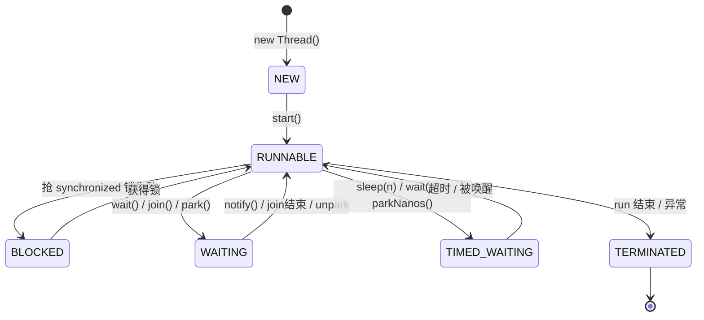

# 01 · 线程基础与生命周期

> 🎬 **配套交互演示**：[diagrams/thread-lifecycle.html](../../diagrams/thread-lifecycle.html)——点按钮触发事件，看线程"小球"在六个状态间流转动画（本地浏览器打开）。

## 线程是什么

进程 = 操作系统分配资源的最小单位（一个 JVM 就是一个进程）；**线程 = CPU 调度的最小单位**。一个 JVM 进程里的多个线程**共享堆和方法区**，各自持有栈、程序计数器——"共享堆"是并发问题的根源（大家改同一块内存），"私有栈"是线程私有大对象的原因。

## 创建线程的三种方式（第四种以后讲）

```java
// 方式一：继承 Thread（不推荐——Java 单继承，继承就占掉了唯一名额）
class MyThread extends Thread {
    @Override public void run() { System.out.println("run"); }
}
new MyThread().start();     // 注意是 start 不是 run！run 是普通方法调用

// 方式二：实现 Runnable（推荐——不占用继承，配合线程池）
Runnable task = () -> System.out.println("run");   // Lambda 实现函数式接口
new Thread(task).start();

// 方式三：实现 Callable + Future（有返回值、可抛异常、可取消）
Callable<Long> task = () -> { Thread.sleep(100); return 100L; };
FutureTask<Long> future = new FutureTask<>(task);
new Thread(future).start();
Long result = future.get();   // 阻塞直到完成
```

**start vs run 面试经典**：`run()` 只是普通方法调用（当前线程串行执行）；`start()` 才会让 JVM 创建新线程并回调 run。对已 start 的线程再次 start 抛 `IllegalThreadStateException`。

## 六种生命周期状态（背）



| 状态 | 触发 | 关键 API |
|------|------|---------|
| NEW | new 出来还没 start | — |
| RUNNABLE | start 后 / 被唤醒后 | （Java 的"就绪+运行中"合并为一个状态，运行与否取决于 CPU 调度） |
| BLOCKED | 等 synchronized 锁 | — |
| WAITING | 死等 | `wait()` `join()` `LockSupport.park()` |
| TIMED_WAITING | 限时等待 | `sleep(ms)` `wait(ms)` `parkNanos()` |
| TERMINATED | run 结束/异常退出 | — |

**三组易混 API 对比（必考）**：

| | 归属 | 是否释放锁 | 用途 |
|--|------|-----------|------|
| `sleep(ms)` | **Thread 静态方法** | ❌ 不释放 | 让当前线程歇一会 |
| `wait()` | **Object**（必须持锁才能调） | ✅ 释放锁 | 线程间协作（配合 notify） |
| `join()` | Thread 实例方法 | ❌ | 等**那个线程**执行完（父线程调子线程.join()） |

> [!IMPORTANT]
> `sleep` 在哪个线程里调用就睡哪个线程；`wait/notify` 必须在 `synchronized` 块内调用（否则抛 `IllegalMonitorStateException`）——因为 wait 本质是"进入对象锁监视器的等待队列"。

- `sleep` 在哪调用睡哪个线程；`wait` 让出的是"锁监视器上的等待队列"位置——所以 wait/notify 必须在 synchronized 块内（否则 `IllegalMonitorStateException`）。
- `join()` 内部就是 `wait(0)` 循环——等目标线程死亡。

## 线程中断：协作式的"请假条"

Java 没有强制杀线程的 API（`stop()` 已废弃——可能拿着锁就死了）。中断是**协作式**的：发通知，线程自己决定何时停。

```java
Thread worker = new Thread(() -> {
    while (!Thread.currentThread().isInterrupted()) {   // 每轮循环检查"请假条"
        try {
            doWork();
            Thread.sleep(1000);        // sleep 时被中断 → 抛 InterruptedException 并清除标志
        } catch (InterruptedException e) {
            Thread.currentThread().interrupt();   // ★ 捕获后恢复中断标志（sleep 清除了它）
            break;                                 // 然后优雅退出
        }
    }
});
worker.start();
worker.interrupt();        // 发出中断请求（不是 kill！）
```

**三条铁律**：

> [!WARNING]
> 捕获 `InterruptedException` 后**必须**恢复标志（`thread.currentThread().interrupt()`）或继续上抛——吞掉它等于把请假条撕了，线程会带着"已中断"的假象继续跑。

## 守护线程（Daemon）

```java
thread.setDaemon(true);   // 必须在 start 前设置
```
守护线程 = "后台服务线程"（GC 就是典型的守护线程）。**JVM 退出条件：所有非守护线程结束**——只剩守护线程时 JVM 直接关闭（守护线程骤死，不执行 finally）。这解释了一个常见坑：主线程结束后"为什么我的定时线程死了"——因为它没设非守护。

## 动手任务

```java
public class LifecycleDemo {
    public static void main(String[] args) throws Exception {
        Thread t = new Thread(() -> {
            try { Thread.sleep(2000); } catch (InterruptedException e) { }
        });
        System.out.println(t.getState());        // NEW
        t.start();
        System.out.println(t.getState());        // RUNNABLE
        Thread.sleep(100);
        System.out.println(t.getState());        // TIMED_WAITING
        t.join();
        System.out.println(t.getState());        // TERMINATED
    }
}
```

## 面试问法

**Q: 线程有哪几种状态？sleep 和 wait 的区别？**
A: 六种：NEW/RUNNABLE/BLOCKED/WAITING/TIMED_WAITING/TERMINATED。sleep 是 Thread 静态方法、不释放锁、到时自动醒；wait 是 Object 方法、必须在 synchronized 内调用、会释放锁、靠 notify 唤醒——本质区别是 wait 参与锁的等待-通知机制。join 内部就是 wait。中断是协作式的：interrupt 只设置标志/唤醒阻塞，线程自己决定退出。

---

**下一篇**：[02-synchronized与锁原理](02-synchronized与锁原理.md)——Java 并发第一把锁的底层真相。
