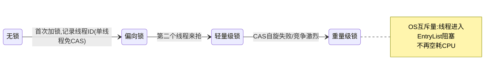

# 02 · synchronized 与锁升级

Java 并发第一课的关键字。三个层次掌握：**怎么用（入门）→ 为什么安全（互斥+可见性）→ 底层如何快（锁升级，面试王炸）**。

## 先看没有锁的世界有多乱

```java
public class CounterDemo {
    static int count = 0;
    public static void main(String[] args) throws Exception {
        Runnable r = () -> { for (int i = 0; i < 10_000; i++) count++; };  // count++ = 读→加1→写 三步
        Thread t1 = new Thread(r), t2 = new Thread(r);
        t1.start(); t2.start(); t1.join(); t2.join();
        System.out.println(count);   // 大概率 < 20000（如 17382），每次运行都不同！
    }
}
```

两个丢失来源：**读-改-写三步交错**（都读到旧值，写回互相覆盖）+ **可见性**（工作内存副本没刷回）。synchronized 同时解决两者。

## 三种用法与锁的对象（背）

| 用法 | 锁的是谁 |
|------|---------|
| `synchronized void method()` | **this**（实例对象） |
| `static synchronized void method()` | **Class 对象**（全局唯一） |
| `synchronized (obj) { }` | **obj 这个对象**（你指定的） |

**锁的是什么，就竞争什么**：两个线程分别调不同实例的同步方法 → 不互斥（锁的是各自的 this）。锁 Class 对象的方法和锁 this 的方法**也不互斥**——经典坑。

## 原理：对象头 + Monitor

每个 Java 对象头里有一段 **Mark Word**（64 位 JVM 占 8 字节），锁状态就存在这里（无锁/偏向/轻量级/重量级，2 位标志位区分）。而 `synchronized` 的语义由对象的 **Monitor（监视器）** 实现——每个对象关联一个 Monitor，里面三个角色：

```
Monitor:
  Owner：当前持锁线程（只有一个）
  EntryList：抢锁失败后阻塞排队的线程（BLOCKED 状态，OS 互斥量实现）
  WaitSet：调 wait() 进入的等待集合
```

字节码层面：同步代码块 = `monitorenter`（进入时拿 Owner）+ `monitorenter exit = monitorexit`（异常路径也有一个 monitorexit 保证释放）；同步方法 = 方法flags 上的 `ACC_SYNCHRONIZED` 标志。

**可重入**：Owner 线程重复进入同一把锁 +1（计数器），退出 -1，归零才真释放——所以同步方法内调另一个同步方法不会死锁。

## 锁升级（JDK 6 优化，面试核心）

重量级锁 = 依赖 OS 互斥量（mutex），涉及用户态/内核态切换，一次加锁可能几十微秒。但**大部分锁根本没有竞争**（单线程反复加）或只有短暂竞争——于是 JDK 6 引入"随竞争升级"的多级锁：



| 级别 | 适用场景 | 实现方式 | 成本 |
|------|---------|---------|------|
| **偏向锁** | 只有一个线程反复加锁 | Mark Word 记录线程 ID，之后该线程进入**免 CAS** | 几乎零成本；有第二个线程来抢 → 升级 |
| **轻量级锁** | 两线程交替加锁（不激烈） | 栈上 Lock Record + **CAS 自旋**抢 Mark Word | 自旋消耗 CPU，适合持锁时间短；自旋失败/有等待 → 膨胀 |
| **重量级锁** | 竞争激烈/持锁时间长 | OS 互斥量，抢不到的进 EntryList 阻塞 | 涉及内核切换，但不再空耗 CPU |

为什么"只升不降"：撤销偏向/降级需要全局安全点（stop-the-world 级别检查），代价大于收益。（JDK 15 起偏向锁默认禁用并标记废弃——现代应用偏向锁的收益已被其它优化覆盖；面试答"锁升级链路+JDK15 移除偏向锁"是加分项。）

动手看锁升级：

```java
Object o = new Object();
System.out.println(ClassLayout.parseInstance(o).toPrintable().substring(0, 56));
synchronized (o) { }                        // 可加 -XX:BiasedLockingStartupDelay=0 观察
System.out.println(ClassLayout.parseInstance(o).toPrintable().substring(0, 56));
// 依赖 org.openjdk.jol:jol-core，看 Mark Word 的 8 个字节怎么变
```

## synchronized 的两个隐式保证（别忽略）

1. **互斥**：同一时刻一个 Owner。
2. **可见性+有序性**：进入同步块 = 清空工作内存副本从主存读；退出 = 刷新回主存。所以**被 synchronized 保护的所有变量，读写都看到了最新值**（不需要再 volatile）。

## 生产坑清单

> [!CAUTION]
> 以下四类坑全部来自真实生产事故的抽象，代码评审时逐条对照。

| 坑 | 说明 |
|----|------|
| 锁对象被换 | `synchronized (obj)` 里 obj 被重新赋值 → 两线程锁了不同对象。**锁对象声明成 final** |
| 锁 String/Integer 缓存对象 | `"abc"` 常量池共享、Integer 缓存 -128~127 → 锁了全局共享对象，莫名的互相干扰 |
| this 锁暴露 | 同步方法把 this 传出去让别人 `synchronized(this)` → 外部代码能干扰你的锁。私有锁对象：`private final Object lock = new Object()` |
| 锁粒度过大 | 整个方法同步但只有一行需要同步 → 吞吐下降。只锁临界区 |

## 与虚拟线程（stage6/01）的呼应

`synchronized` 块内阻塞会**钉死（pin）虚拟线程的载体线程**（JDK 21 限制）——所以 stage6/01 建议 IO 场景改用 `ReentrantLock`。学完本篇你懂了：这是锁升级/Owner 机制在 Loom 下的新代价（JDK 24 已解决）。

## 面试问法

**Q: synchronized 原理？锁升级过程？**
A: 基于 object 的 Monitor：Mark Word 存锁状态，字节码 monitorenter/exit，Owner 唯一+可重入计数。锁升级：无锁→偏向锁（单线程重入免 CAS，Mark Word 记线程ID）→轻量级锁（交替竞争，CAS 自旋）→重量级锁（OS 互斥量+线程阻塞）。偏向锁 JDK15 默认废弃。synchronized 还提供可见性（进出同步块刷主存）。

**Q: synchronized 和后面要学的 ReentrantLock 区别？**
A: 见 [06-AQS 篇](06-AQS与显式锁.md) 对比表——先留个钩子：功能上 lock 多了 tryLock/可中断/公平锁；实现上一个 JVM 内置一个 AQS。

---

**下一篇**：[03-volatile与JMM内存模型](03-volatile与JMM内存模型.md)——可见性和有序性的根源。
