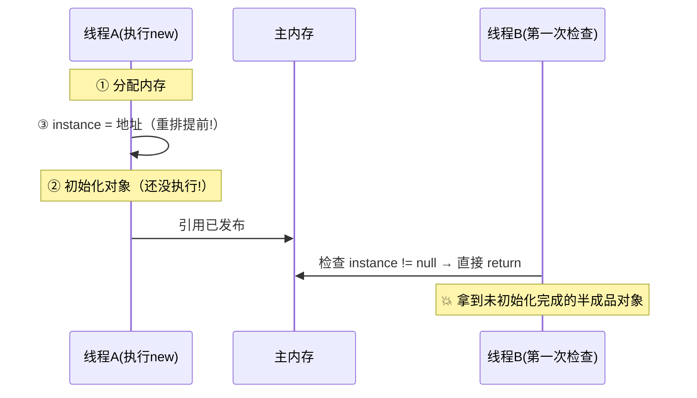

# 03 · volatile 与 JMM 内存模型

synchronized 解决了互斥，但太重了——很多场景只需要**可见性**（一个线程改的值，别的线程立刻看到）。volatile 就是为这个而生的轻量级方案。要理解它必须先懂 **JMM（Java 内存模型）**。

## JMM：并发可见性问题的根源

JMM 是 Java 定义的**抽象规范**（不是物理结构），描述多线程如何与内存交互：

```
每个线程有自己的【工作内存】（本地副本）
            ↕ save/load（何时同步？JVM 说了算——这正是问题）
所有线程共享【主内存】（堆里的真值）
```

```java
static boolean running = true;          // 没有 volatile！

// 线程A
new Thread(() -> { while (running) { doWork(); } }).start();

// 线程B（1 秒后想停掉 A）
Thread.sleep(1000);
running = false;                        // 线程A 可能永远停不下来！
```

线程 B 改了主内存的值，但线程 A 的工作内存里 running 副本还是 true，**且 JIT 可能优化成 `if (true) while`**——循环永远不结束。加 `volatile` 立刻解决。

## volatile 的两个保证（和一个不保证）

| 保证 | 说明 | 实现 |
|------|------|------|
| ✅ **可见性** | 写 volatile 变量 → 立即刷回主存；读 → 从主存读（禁用工作内存缓存） | 底层是 **内存屏障**（写后插 StoreLoad 屏障，x86 上是 `lock` 前缀指令，强制刷 store buffer 并使其它核的缓存行失效——MESI 缓存一致性协议接管） |
| ✅ **禁止指令重排** | volatile 读写前后的指令不会被重排到另一侧 | 编译器/CPU 层的内存屏障 |
| ❌ **不保证原子性** | `count++` 仍是"读改写"三步，volatile 救不了 | 需要锁或 CAS（stage5/04） |

### 指令重排与双重检查锁（DCL）——volatile 的招牌场景

CPU/编译器为了性能会**乱序执行**指令（只要单线程语义不变）。单线程没事，多线程会看到"半成品"：

```java
// 双重检查锁单例（DCL）——错误版
public class Singleton {
    private static Singleton instance;              // ← 缺 volatile 的 bug！
    public static Singleton getInstance() {
        if (instance == null) {                     // 第一次检查（无锁，大多数请求在这返回）
            synchronized (Singleton.class) {
                if (instance == null) {
                    instance = new Singleton();     // ← 问题在这里！
                }
            }
        }
        return instance;
    }
}
```

`new Singleton()` 在字节码/机器码层面是**三步**：



修复：`private static volatile Singleton instance;`——volatile 禁止 2/3 重排（写前插 StoreStore 屏障，保证先初始化再发布），同时保证线程 B 读到的是完整对象。

### happens-before：JMM 的"秩序承诺清单"

JMM 不禁止所有重排（那就没法优化了），而是定义了一组 **happens-before 规则**——满足这些规则的操作对，前一个的结果对后一个**必然可见**：

| 规则 | 白话 |
|------|------|
| 程序顺序规则 | 单线程内，前面的操作 happens-before 后面的 |
| 锁规则 | 解锁 happens-before 后续对同一把锁的加锁（所以 synchronized 里有可见性） |
| **volatile 规则** | volatile 写 happens-before 后续对该变量的读 |
| 线程启动/终止 | start() 前的操作对新线程可见；线程结束后它的结果对 join() 返回后的代码可见 |
| 传递性 | A hb B，B hb C → A hb C |

**判断并发可见性 bug 的方法**：找不到任何一条 happens-before 链连接"写"和"读"→ 一定有可见性问题。volatile/锁/final/线程 start-join 都是建立 hb 链的手段。

## 什么时候用 volatile（使用场景判断）

✅ **一写多读**（配置开关、状态标志）——读多写少且写不依赖旧值：

```java
volatile boolean shutdown = false;    // 停机开关
volatile Map<String, Config> configRef;   // 整体替换引用（不可变对象发布）
```

✅ **DCL 单例**（禁止重排）
❌ `count++`（非原子）→ 用 AtomicLong（CAS，[04 篇](04-CAS与原子类.md)）或锁
❌ 复合状态判断（`if (!initialized) { initialized=true; init(); }`——两个线程都可能进 init）

## 三个相关关键词顺手记

| 关键字 | 作用 |
|--------|------|
| `final` | 初始化后不可变；**正确发布**的不可变对象天然线程安全（final 有内存语义：构造函数写 final 字段 hb 于其它线程读该对象） |
| `static` 初始化顺序 | 类初始化由 JVM 加锁保证——**静态单例（饿汉）天然线程安全**，很多场景不需要 DCL |
| `record` / 不可变对象 | 所有字段 final + 无 setter → 随便共享，零同步成本。**并发设计第一原则：能不可变就不可变** |

## 面试问法

**Q: volatile 的作用和原理？能替代锁吗？**
A: 保证可见性与有序性、不保证原子性。原理：写操作插 StoreLoad 内存屏障（x86 lock 前缀）强制刷主存并使其它核缓存失效；编译器/CPU 层禁止指令重排，建立了 volatile 写 hb 读的 happens-before。不能替代锁——count++ 这类复合操作仍交错；适用"一写多读的状态标志"与 DCL 单例（禁止初始化与赋值重排）。

**Q: DCL 单例为什么要 volatile？**
A: new 的三步（分配/初始化/赋引用）中初始化与赋引用可能重排；无 volatile 时其它线程第一次检查可能拿到未初始化完的引用。volatile 禁止重排+可见性修复。补充：静态饿汉单例由类初始化锁天然线程安全，无需 DCL。

---

**下一篇**：[04-CAS与原子类](04-CAS与原子类.md)——不加锁也能改对数据。
