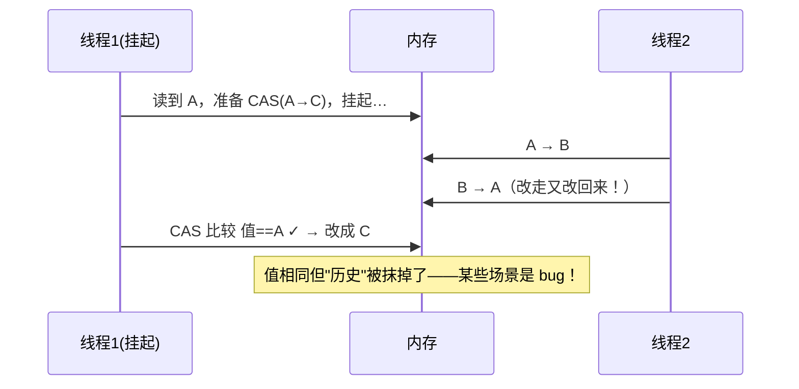

# 04 · CAS 与原子类

> 🎬 **配套动画**：[diagrams/cas-aba.html](../../diagrams/cas-aba.html)——ABA 时序逐帧演示：❌无版本号下 CAS"透过"改走又改回来成功、无锁栈栈顶回拨链断；✅AtomicStampedReference 版本号拆穿并重试成功。

上一章的结论：`count++` 非原子，synchronized 能解决但太重。有没有**不加锁**的原子方案？有——CAS。

## CAS：Compare-And-Swap（比较并交换）

一条**CPU 原子指令**（x86 的 `lock cmpxchg`）：**"如果内存值 == 预期值，就更新为新值，返回成功与否"**——判断+更新在硬件层一步完成：

```java
// AtomicInteger.incrementAndGet 的本质（伪代码）
public int incrementAndGet() {
    int oldValue, newValue;
    do {
        oldValue = get();                    // 读当前值（预期值）
        newValue = oldValue + 1;             // 计算新值
    } while (!compareAndSet(oldValue, newValue));  // CAS：内存值==oldValue 才写入
    return newValue;
}
```

失败不阻塞、不自旋等待别人（和 synchronized 抢锁不同）——**失败了就再读再试**（自旋重试），天然无锁、无线程切换。

## 原子类全家桶（java.util.concurrent.atomic）

| 类 | 场景 |
|----|------|
| `AtomicInteger/Long/Boolean` | 计数、状态标志（替代 volatile + 锁的组合拳） |
| `AtomicReference<V>` | 对象引用的原子替换（无锁栈的基础） |
| `AtomicIntegerArray/LongArray` | 数组元素原子操作 |
| `AtomicIntegerFieldUpdater` | 给**已有类的 volatile 字段**补原子操作（不改动类结构） |
| `LongAdder` ★ | 高并发计数的终极答案（见下） |
| `LongAccumulator` | 自定义聚合（max/min/任意 accumulate 函数） |

```java
// 对比（stage3/02 的 Redis INCR 逻辑在 JVM 内的等价物）
AtomicInteger count = new AtomicInteger();
count.incrementAndGet();                  // 原子 +1
count.compareAndSet(100, 200);            // 期望100 → 改成200

// LongAdder：高并发计数的性能王者
LongAdder adder = new LongAdder();
adder.increment();
adder.sum();      // 读时汇总所有分段
```

**LongAdder 为什么快**：AtomicLong 所有线程 CAS 同一个变量，高并发下自旋冲突率暴涨；LongAdder **分段累加**（Cell[] 数组，线程哈希到不同 Cell 上各加各的，几乎零冲突），`sum()` 时汇总——**空间换性能，写多读少场景的答案**。

## ⭐ ABA 问题：CAS 的第一道面试关

CAS 只校验"**值**是否等于预期"——不关心这个值**经历过什么**：



```
线程1：读到 A，准备改成 C（此时被挂起）
线程2：A → B → A（改走又改回来！）
线程1：恢复执行，CAS 比较 值==A ✓ → 改成 C 成功
       → 但中间发生过变化，某些场景下这是 bug！
```

**什么时候 ABA 有害**：状态不只是"值"而是"历史"时。经典案例——**无锁栈**：

```
栈顶是 A（节点A）
线程1 准备把栈顶从 A 换成 B（CAS A→B），挂起
线程2：弹出 A，又 push 回一个值也是 A 的新节点（新 A，复用了旧内存）
线程1 恢复：CAS 栈顶 A→B 成功
→ 栈结构坏了！线程2 之后 push 的节点全丢失
```

**解法：版本号**。每次修改版本 +1，CAS 同时比较"值+版本"：

```java
AtomicStampedReference<String> ref = new AtomicStampedReference<>("A", 0);   // (引用, 戳)
int[] stamp = new int[1];
String old = ref.get(stamp);                       // 拿到引用和版本号
ref.compareAndSet(old, "C", stamp[0], stamp[0] + 1);   // 值和版本都要匹配
```

> **与 Redis 的呼应**（stage3/02）：Redis 里防 ABA 用的也是同一招——乐观锁版本号 `WHERE version=?`、分布式锁的 requestId、Redis Stream 的消息 ID。**"值+版本"双要素 CAS 是分布式系统通用的思维**，学 CAS 时建立的概念在 Redis 篇里完全复用。

## CAS 的另外两个代价

1. **自旋失败空耗 CPU**：竞争极激烈时，大量线程反复读-CAS-失败。解法：LongAdder 分段 / 限制自旋次数 / 退回锁。
2. **只能保证单个变量的原子性**：两个变量联合判断做不到（解法：封装成不可变对象放 AtomicReference，或上锁）。

## 什么时候用 CAS vs 锁（选型）

| 场景 | 选择 |
|------|------|
| 简单计数/标志位、竞争不激烈 | 原子类（无锁开销） |
| 高并发纯计数 | **LongAdder** |
| 复合逻辑（多变量/复杂判断） | synchronized/ReentrantLock（代码可读性、可维护性优先） |
| 读多写少 + 允许旧值短窗口 | volatile |

**与 Redis 的分工呼应**（stage3/03 分布式锁的 DB 兜底思想一致）：JVM 内的原子性用原子类/锁；**跨进程/跨实例**的原子性用 Redis Lua（`INCR`/`SET NX`）——原子性永远依赖"单一串行执行点"：CPU 指令、JVM 锁、Redis 单线程，本质相同。

## 面试问法

**Q: CAS 是什么？有什么问题？**
A: Compare-And-Swap，CPU 原子指令：内存值==预期值才更新，失败自旋重试。JUC 原子类的基础（Unsafe.compareAndSwap）。三个问题：①**ABA**（值回到旧值但历史已变——AtomicStampedReference 加版本号解决，分布式系统同样用乐观锁版本号）；②自旋失败耗 CPU（LongAdder 分段解决）；③单变量原子性（多变量封装不可变对象或上锁）。

**Q: AtomicLong 和 LongAdder 怎么选？**
A: AtomicLong 所有线程 CAS 同一变量，高并发自旋冲突率高；LongAdder 分段 Cell 累加几乎零冲突，sum() 读时汇总。写多读少的计数选 LongAdder；需要精确读值/低并发选 AtomicLong（还支持 CAS 条件更新）。

---

**下一篇**：[05-线程池ThreadPoolExecutor](05-线程池ThreadPoolExecutor.md)——后端面试最高频的并发考点。
