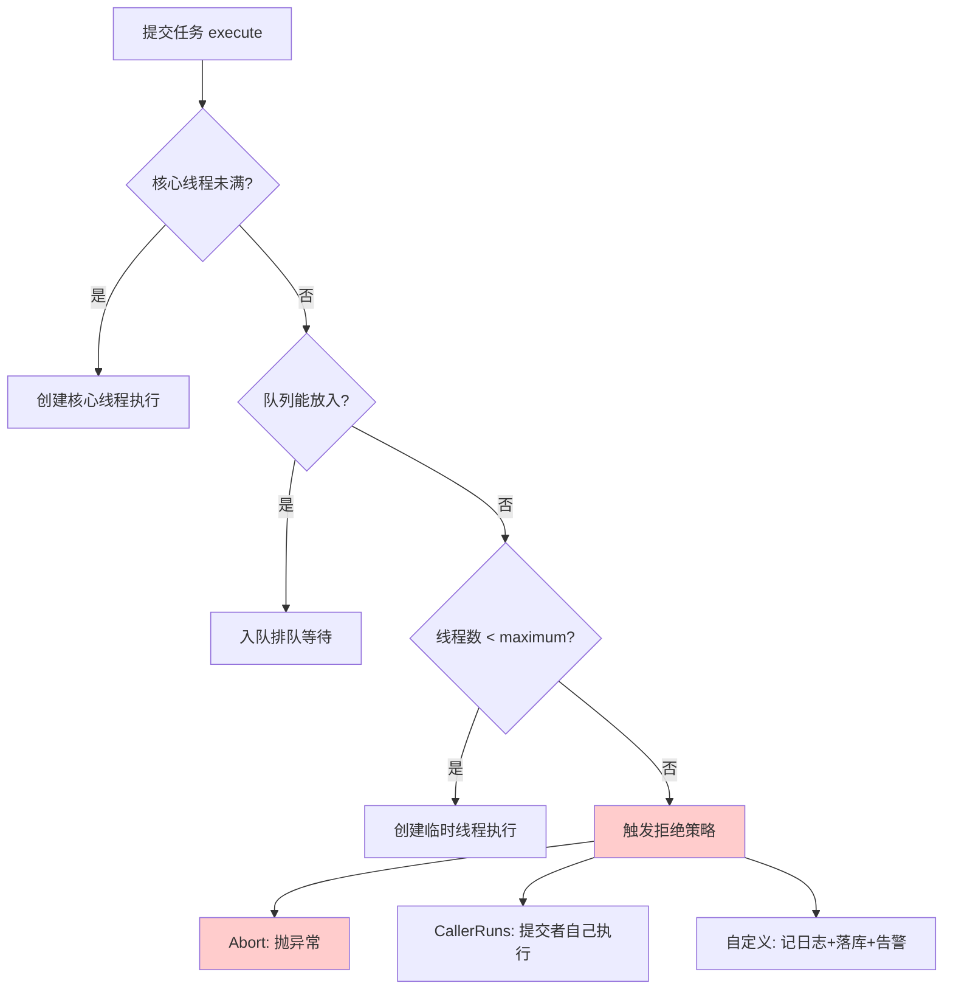

# 05 · 线程池 ThreadPoolExecutor

> 🎬 **配套交互演示**：[diagrams/thread-pool.html](../../diagrams/thread-pool.html)——可调参数的线程池动画：提交任务看它走"核心→队列→临时→拒绝"哪条路；把队列调到 9999 亲历无界队列 OOM 坑。

**后端面试出现率最高的并发考点**，没有之一。也是生产事故高发地（队列堆积、OOM、任务丢失）。学完本篇你能回答"线程池参数怎么设"以及"为什么参数设错了会 OOM"。

## 为什么需要线程池

线程 = 贵（1MB 栈 + 创建销毁成本 + 调度开销）。线程池的价值：

1. **复用**：创建/销毁一次，干活 N 次
2. **削峰限流**：并发超过容量时排队/拒绝，保护系统
3. **统一管理**：命名、监控、超时

> 呼应 stage6/01：虚拟线程时代"复用"的价值下降（不池化），但"**限流与容量控制**"的价值反而更清晰了——虚拟线程不设上限，DB 连接池才是瓶颈；而平台线程池的线程数本身就是限流器。

## ThreadPoolExecutor 七大参数（必背）

```java
public ThreadPoolExecutor(
    int corePoolSize,            // ① 核心线程数：常驻，不回收（除非 allowCoreThreadTimeOut）
    int maximumPoolSize,         // ② 最大线程数：核心+临时 的上限
    long keepAliveTime,          // ③ 临时线程空闲存活时间
    TimeUnit unit,               // ④ 存活时间单位
    BlockingQueue<Runnable> workQueue,   // ⑤ 任务队列：核心线程满时任务先排队
    ThreadFactory threadFactory, // ⑥ 线程工厂：命名（排查必备！）
    RejectedExecutionHandler handler     // ⑦ 拒绝策略：队列满+线程到最大 时怎么办
)
```

**执行流程（背这个顺序，很多人记反）**：



**注意顺序**：不是"先开满线程再排队"，而是**先排队，队列满了才加临时线程**。

> [!WARNING]
> `Executors.newFixedThreadPool(10)` / `newSingleThreadExecutor` 用的是**无界 LinkedBlockingQueue**——队列永远不满 → max 参数形同虚设 → 任务无限堆积直到 **OOM**。`newCachedThreadPool` 则相反：线程数无上限 → 万级线程 OOM。这就是《阿里巴巴 Java 开发手册》禁止使用 Executors 快捷方法的原因。

> [!TIP]
> 生产实践：**自定义拒绝策略**——记日志 + 落库/MQ + 告警，而不是简单丢弃。`CallerRunsPolicy` 是一种优雅的天然限流回压：谁提交谁执行，提交速率自动被池子消化速度压下来。

## 四种拒绝策略

| 策略 | 行为 | 场景 |
|------|------|------|
| `AbortPolicy`（默认） | 抛 RejectedExecutionException | 让调用方感知失败（配合重试） |
| `CallerRunsPolicy` | **谁提交谁执行**（提交线程自己跑任务） | 优雅的天然限流回压——提交慢下来，池子消化跟上来 |
| `DiscardPolicy` | 静默丢弃 | ❌ 生产慎用（丢的日志都看不到） |
| `DiscardOldestPolicy` | 丢队列最老的，塞新的 | 只留最新数据场景（如实时行情） |

**生产实践：自定义拒绝策略**——记日志 + 落库/MQ + 告警，而不是简单丢弃：

```java
new ThreadPoolExecutor(..., (r, executor) -> {
    log.error("线程池已满, 任务被拒绝. queueSize={}", executor.getQueue().size());
    deadLetterQueue.offer(r);          // 进"拒绝队列"延后处理
    alertService.notify(...);
});
```

## 为什么禁用 Executors 快捷方法（阿里规约）

```java
// ❌ Executors.newFixedThreadPool(10)  → LinkedBlockingQueue 无界 → 任务堆积 OOM
// ❌ Executors.newSingleThreadExecutor() → 同上
// ❌ Executors.newCachedThreadPool()    → 最大线程 Integer.MAX_VALUE → 万级线程 OOM
// ✓ 手动 new ThreadPoolExecutor，明确每个参数
```

## 参数怎么设（实战公式 + 真相）

教科书公式：

```
CPU 密集型（加密/计算）：    核心数 = CPU 核数 + 1
IO 密集型（调用下游/DB）：   核心数 = CPU 核数 × (1 + 等待时间/计算时间)
```

**真相：公式只是起点，实测压测才是答案**（N 倍关系会随下游耗时波动失效）。实用方法论：

1. 按 CPU 密集/IO 密集估个初值（IO 型一般 2×核数 起步）
2. **压测观察**：目标 QPS 下，线程都在忙（线程数不够）还是大量空闲（线程过多切换浪费）？下游被打挂了（要调小）？
3. 关注**队列容量**：容量 = 峰值 QPS × 可容忍延迟（如 200ms × 5000qps = 1000 容量）——队列是缓冲不是无底洞
4. **动态线程池**：参数做成可调（配置中心 + `setCorePoolSize` 运行时生效），美团方案

## 监控与排查

```java
executor.getActiveCount();     // 活跃线程
executor.getQueue().size();    // 排队数 ← 堆积前兆
executor.getCompletedTaskCount();
executor.getLargestPoolSize(); // 历史最大线程数
```

接到 Micrometer 打到 Prometheus（stage6/04 的 Metrics 支柱），排队数和拒绝数配告警——线程池出事前的信号是**队列持续增长**。

## 与 MQ 的关系（呼应本工作区）

| 线程池 | MQ |
|--------|-----|
| 内存队列，进程内削峰 | Broker 持久化队列，跨进程削峰 |
| 堆满 → 拒绝/丢弃 | 堆积 → 告警扩容 |
| **重启丢队列**（无界队列里的任务全没） | 持久化，重启不丢 |

**判据**：任务**重要到丢了有后果** → 直接走 MQ（mq-mall 所有异步都是 MQ）；**轻量/可丢/进程内**（如异步记日志、本地事件）→ 线程池。**别用无界队列线程池承担"重要任务"**——重启即蒸发。

## 线程池与虚拟线程的衔接

平台线程池的三大职责在虚拟线程时代的变化（stage6/01）：复用（不需要了）、限流（**仍然需要**——信号量/连接池来限）、管理（监控仍然需要）。所以虚拟线程不是"线程池死了"，而是"线程池的池化半边死了，限流半边换形式活着"。

## 面试问法

**Q: 线程池的核心参数和执行流程？**
A: 七参数：core/max/keepAlive/unit/workQueue/threadFactory/handler。流程：核心未满建核心线程 → 满则入队 → 队满建临时线程到 max → 仍不行触发拒绝策略。注意是先排队后扩容，所以无界队列会让 max 失效导致 OOM（Executors 快捷方法的坑），生产手写 ThreadPoolExecutor。

**Q: 线程数怎么设置？**
A: 经验公式 CPU 密集 N+1、IO 密集 N×(1+W/C)（等待/计算比）只是初值；真实值靠压测确定：观察线程忙闲、下游容量、队列延迟目标；生产做动态线程池（配置中心调参运行时生效）+ 队列长度/拒绝数监控告警。

---

**下一篇**：[06-AQS与显式锁](06-AQS与显式锁.md)——ReentrantLock 为什么更强。
