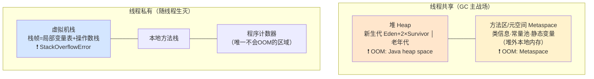

# 01 · 运行时内存区域与对象

## 五大运行时数据区（背）



### 三类 OOM 与它们的位置（对应关系必背）

| 区域 | 溢出异常 | 典型原因 |
|------|---------|---------|
| 堆 | `OutOfMemoryError: Java heap space` | 对象太多/泄漏/堆太小 |
| 元空间 | `OutOfMemoryError: Metaspace` | 动态生成类太多（CGLib/反射滥用） |
| 虚拟机栈 | `StackOverflowError` | 递归太深/栈帧太大（注意这是 Error 不是 OOM） |

动手复现（先 `-Xmx16m -Xms16m` 限制堆）：

```java
// 堆溢出：List<Object> list = new ArrayList<>(); while(true) list.add(new Object());
// 栈溢出：public void r(){ r(); }  main 里调用 r();
// 元空间：循环用 CGLib 生成类的代理类
```

## 对象的一生（从 new 到死亡）

```
new Object()
  → ①类没加载？先触发类加载（下一章）
  → ②分配内存（指针碰撞 / 空闲列表；TLAB：每个线程在 Eden 私有一小块，免竞争）
  → ③零值初始化（字段置默认值）
  → ④设置对象头（Mark Word 锁状态/hash/分代年龄 + 类型指针）
  → ⑤执行 <init> 构造方法
  → 在 Eden 区出生
  → 每熬过一次 Minor GC，年龄+1；年龄 15（默认）→ 晋升老年代
  → 大对象（如大数组）直接进老年代（-XX:PretenureSizeThreshold）
  → 老年代也满了 → Full GC → 不可达 → 被回收
```

## 对象在内存里长什么样（对象布局）

```
┌──────────── 对象头 Header (16B) ────────────┐
│ Mark Word (8B)：hash/GC分代年龄/锁状态        │  ← synchronized 锁升级就改这里（并发篇02）
│ 类型指针 Klass Pointer (4B 压缩) → 元空间类信息 │
├──────────── 实例数据 ────────────────────────┤
│ 字段值（相同宽度字段排一起——紧凑）              │
├──── Padding（补齐到 8 字节整数倍）────────────┤
└─────────────────────────────────────────────┘
```

**内存对齐与压缩指针**：堆 ≤32GB 时类型指针压缩成 4 字节（`-XX:+UseCompressedOops` 默认开）——**这就是"堆超过 32GB 性能反而可能下降"的原因**（指针变 8 字节，同样的对象占更多内存）。生产调堆别拍脑袋设 64G。

## 栈帧：方法调用的现场（排查问题的基础概念）

每次方法调用压入一个栈帧：

```
栈帧 = 局部变量表 | 操作数栈 | 动态链接 | 返回地址
递归没出口 → 栈帧无限压入 → StackOverflowError
-Xss256k 可调每线程栈大小（线程多时调小省内存；栈帧大的递归调大）
```

jstack 抓到的线程堆栈就是"栈帧链"——排查 CPU 100%（04 篇）时看的就是它。

## 逃逸分析与栈上分配（JIT 的优化魔法）

理论上对象在堆上分配，但 JIT 编译器会做**逃逸分析**：对象没逃出方法作用域 → 直接在**栈上分配**（或标量替换拆成基本类型放寄存器）——方法结束自动消失，**零 GC 压力**。

```java
// obj 没逃出方法 → JIT 可能栈上分配（无论如何这代码写法是对的，优化是免费的）
public int compute() {
    Point p = new Point(1, 2);   // 未逃逸
    return p.x + p.y;
}
```

`-XX:+DoEscapeAnalysis` 默认开。这回答了"为什么有些代码 new 得很凶但 GC 却不频繁"。

## String 的特殊性（顺带）

- 字符串常量池在堆里（JDK7 从方法区搬过来的）
- `String s = "a"` 常量池复用；`new String("a")` 堆里新对象
- `intern()` 把堆字符串放入常量池返回常量池引用（海量重复字符串场景省内存）

## 面试问法

**Q: JVM 运行时数据区有哪些？哪些线程共享？**
A: 共享：堆（对象实例，GC 主战场，新生代 Eden+2Survivor/老年代）、方法区（JDK8 为元空间，在本地内存，存类信息）。线程私有：虚拟机栈（栈帧=局部变量表/操作数栈）、本地方法栈、程序计数器。对应异常：堆 OOM heap space、元空间 OOM Metaspace、栈 StackOverflowError。

**Q: 对象一定在堆上分配吗？**
A: 理论上堆上（TLAB 优先在 Eden 私有快分配）；但 JIT 逃逸分析后，未逃逸对象可标量替换为栈上分配/寄存器，方法结束自动回收，不进 GC。大对象直接进老年代。

---

**下一篇**：[02-类加载机制](02-类加载机制.md)。
