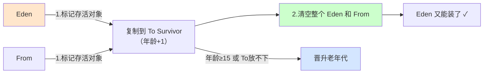
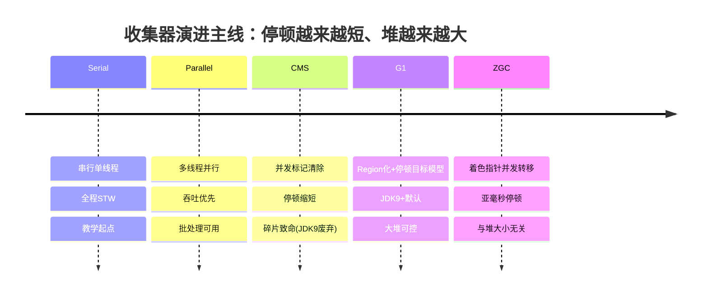

# 03 · 垃圾回收：算法与收集器

> 🎬 **配套交互演示**：[diagrams/g1-gc.html](../../diagrams/g1-gc.html)——96 个 Region 的堆可视化：分配对象看 Eden 满→Minor GC→晋升→Mixed GC 的数字与颜色变化。

Java 的招牌能力。目标：搞清**哪些对象该回收（判定）、怎么回收（算法）、谁来回收（收集器）**，最终落到"为什么 G1/ZGC 能做到低停顿"。

## 一、判定对象生死

### 可达性分析（现代 GC 的标准答案）

从 **GC Roots** 出发，沿引用链走——**走不到的就是垃圾**：

```
GC Roots：
  虚拟机栈中引用的对象（正在执行的方法里的局部变量）
  静态变量引用的对象
  常量引用的对象
  JNI（native）引用的对象
  活跃线程对象
```

> 为什么不用"引用计数"（数引用数）：**循环引用**（A↔B 互相引用但都对程序无用）计数永不归零——Python 的 gc 模块为此打补丁，Java 直接选了可达性。

### 四种引用（理解"可回收的弹性"）

| 引用 | 何时回收 | 用途 |
|------|---------|------|
| 强引用 `Object o = ...` | 永不（可达就活） | 默认 |
| 软引用 SoftReference | 内存不足才回收 | 缓存（内存紧张让位） |
| 弱引用 WeakReference | 下次 GC 必回收 | ThreadLocal 的 key！（并发篇07 的泄漏原理） |
| 虚引用 PhantomReference | 无法取值，仅收到死亡通知 | 堆外内存回收管理（NIO DirectByteBuffer） |

### 对象"死亡"的最后机会：finalize

对象不可达后如果重写了 `finalize()` 且没执行过 → 进 F-Queue 由低优先级线程执行——可以在里面"自我复活"（重新建立引用）。**生产禁用**：执行时间无保证、可能复活制造僵尸。想释放资源用 try-with-resources/Cleaner。**一个对象的 finalize 只会执行一次**（复活过就直接回收）。

## 二、回收算法（三种基本套路）

| 算法 | 过程 | 优点 | 缺点 | 用于 |
|------|------|------|------|------|
| **标记-清除** | 标记存活→清除垃圾 | 简单 | **内存碎片**、效率一般 | CMS 老年代 |
| **标记-复制** | 存活对象**复制**到另一半 → 整块回收 | 无碎片、高效 | 浪费一半空间 | **新生代**（存活率低，复制少） |
| **标记-整理** | 标记→存活对象向一端移动 | 无碎片 | 移动有成本 | 老年代 |

**为什么新生代用复制、老年代用整理**：新生代对象"朝生夕死"（存活率 <10%），复制少量存活对象很划算（且 Eden:Survivor 8:1:1 只浪费 10% 空间）；老年代对象存活率高（复制开销大）且无额外空间担保——用"整理"压缩碎片。

### 新生代回收流程（Minor GC 全过程）





对象晋升老年代的四个途径：年龄达标 / 大对象直接进 / To Survivor 放不下 / **动态年龄判断**（同龄对象总和超过 Survivor 一半，该年龄以上全部晋升——防存活对象挤爆 Survivor）。

## 三、收集器进化史（CMS → G1 → ZGC）

### CMS（并发标记清除，JDK9 废弃，了解即可以理解 G1 动机）

```
初始标记（STW，短）→ 并发标记（与业务并行）→ 重新标记（STW，修正并发期间的变化）→ 并发清除
```
优点：大部分工作并发，停顿短。**死穴：内存碎片（标记清除）+ 浮动垃圾（并发清理期间产生的新垃圾）+ "并发失败"退化为 Full GC**。

### G1（Garbage First，JDK9+ 默认）——从"分代物理隔离"到"Region 化"

革命性变化：堆切成 **2048 个等大 Region**，每个 Region 动态扮演 Eden/Survivor/Old，还支持**巨型对象 Region（Humongous）**：

```
按停顿时间目标工作：-XX:MaxGCPauseMillis=200（默认 200ms）
G1 跟踪各 Region 的"垃圾价值"（回收收益/耗时比），每次只挑收益最高的一批 Region 回收
   → "Garbage First"：先回收垃圾最多的区域
   → 停顿时间可控可预测（按目标倒推收集多少 Region）
```

- 仍然分代（逻辑分代，Region 物理上不连续）
- 大对象（>Region 一半）直接进 Humongous Region
- 碎片：整体基于"标记-复制/整理"，无传统碎片
- 适用：**大堆（6GB+）+ 要求停顿可控**——现在生产默认选择

### ZGC / Shenandoah（低延迟，JDK 15+ 正式，亚毫秒停顿）

- **着色指针**（ZGC）：指针里存 GC 信息，并发完成标记/转移/重定位
- **停顿 <1ms**（与堆大小无关！几十 GB 也是毫秒级），代价：吞吐略降（~10%）
- 适用：超大堆 + 极致延迟敏感（交易系统、实时服务）

```bash
# 启用方式（生产写法）
java -XX:+UseZGC -Xmx16g app.jar
java -XX:+UseG1GC -Xms8g -Xmx8g -XX:MaxGCPauseMillis=200 app.jar
```

### 收集器演进一句话总结

```
Serial(串行) → Parallel(吞吐优先，多线程并行) → CMS(低停顿，有碎片，已废)
→ G1(Region化，停顿可控，默认) → ZGC/Shenandoah(亚毫秒停顿，大堆)
演进主线：停顿越来越短、堆越来越大、吞吐代价越来越可控
```

## 停顿的本质（理解所有收集器的钥匙）

所有 GC 都有"必须 STW 的阶段"（要保证对象关系图不变）。收集器的进化 = **把必须停顿的工作变少、变并发、变增量**：

- Parallel：全停顿，吞吐优先
- CMS：标记并发，清除并发，但碎片致命
- G1：Region 化 + 可预测停顿模型（挑着收）
- ZGC：着色指针让"移动对象"也能并发进行（读屏障技术），停顿只剩极短的根扫描

## GC 日志与观察（动手）

```bash
java -Xms1g -Xmx1g -XX:+UseG1GC -Xlog:gc*:file=gc.log app.jar    # JDK9+ 统一日志
# 或用 jstat 观察：jstat -gcutil <pid> 1000   每秒打一次各区占用与 GC 次数
```

重点看的指标：**Minor GC 频率与耗时 / Full GC 是否发生 / 晋升速率**——Full GC 出现且频繁 = 老年代出问题（泄漏或代配比失衡）。

## 面试问法

**Q: 对象什么时候可以被回收？怎么判断？**
A: 可达性分析：从 GC Roots（栈局部变量/静态变量/常量/JNI 引用/活跃线程）沿引用链不可达即为垃圾。不用引用计数是因为循环引用。四种引用提供弹性：软引用内存不足回收（缓存）、弱引用下次 GC 必回收（ThreadLocal key）、虚引用管理堆外内存。

**Q: G1 和 CMS 的区别？为什么 G1 成了默认？**
A: CMS 分代物理隔离+标记清除，死穴是碎片和并发失败退化 Full GC；G1 把堆切 Region、逻辑分代、按"回收收益/成本"优先挑 Region 收集，支持 -XX:MaxGCPauseMillis 停顿目标模型，无碎片（复制/整理）。大堆可控停顿 → JDK9+ 默认。再往后 ZGC 用着色指针实现与堆大小无关的亚毫秒停顿。

---

**下一篇**：[04-JVM调优与常用工具](04-JVM调优与常用工具.md)。
