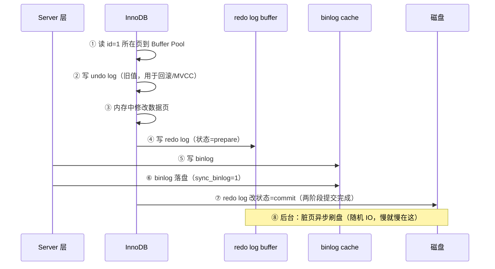

# 04 · 日志体系：redo、undo、binlog 与两阶段提交

一条 `UPDATE` 语句执行时，MySQL 内部写了三种日志。理解它们就理解了 MySQL 的 **crash-safe**（宕机不丢数据）和**主从复制**——也是 [MQ 教学 Debezium CDC](../../stage6-新技术专题/06-Debezium-CDC与Outbox模式.md) 的数据来源。

## 三大日志一览

| 日志 | 层级 | 类型 | 谁写的 | 作用 |
|------|------|------|--------|------|
| **redo log** | InnoDB 引擎层 | 物理日志（"某页某处改成了某值"），**循环写** | 引擎 | 崩溃恢复（crash-safe） |
| **undo log** | InnoDB 引擎层 | 逻辑日志（反向操作），回滚段 | 引擎 | 回滚 + MVCC 版本链 |
| **binlog** | Server 层 | 逻辑日志（SQL/行变更），**追加写** | Server（所有引擎共用） | 主从复制 + CDC/恢复 |

**为什么有了 redo 还要 binlog？** 历史原因：binlog 是 MySQL Server 的通用日志（MyISAM 时代就有），而 redo 是 InnoDB 为实现事务专门造的。两者职责不同：redo 管"引擎崩溃后数据不丢"，binlog 管"把变更复制给从库/下游"。

## 一条 UPDATE 的完整旅程（含两阶段提交）

```sql
UPDATE t_user SET points = points + 10 WHERE id = 1;
```



### 为什么需要两阶段提交（prepare → binlog → commit）？

**反证法**——如果不用两阶段提交，两种崩溃场景都会造成主从不一致：

```
场景X：先写 redo 后写 binlog，redo 写完宕机
  → 恢复后：主库有这条变更（redo 恢复了），binlog 没有 → 从库少了这条 → 主从不一致 ✗

场景Y：先写 binlog 后写 redo，binlog 写完宕机
  → 恢复后：主库没这条变更（redo 没了），binlog 有 → 从库多了这条 → 主从不一致 ✗

两阶段提交：
  redo prepare 后宕机 → 恢复时检查：binlog 完整 → 提交；binlog 不完整 → 回滚
  → 主库与 binlog 永远一致 → 从库永远与主库一致 ✓
```

**记忆口诀：两阶段提交是"redo 和 binlog 的分布式事务"**——你学的分布式事务思想（两阶段提交协议）在这里被 MySQL 官方用在了自家两个日志之间。

## 双 1 配置：数据安全的最高档

```ini
innodb_flush_log_at_trx_commit = 1   # 每次事务提交都 fsync redo（默认）
sync_binlog = 1                       # 每次事务提交都 fsync binlog（默认）
```

| 组合 | 丢数据窗口 | 性能 |
|------|-----------|------|
| 双 1 | 基本不丢 | 最差（每事务两次 fsync） |
| redo=2, binlog=1 | OS 崩溃丢 1 秒 | 好 |
| 双 0 | OS 崩溃丢秒级+主从可能落后 | 最好 |

**金融/订单用双 1**；日志类/可容忍系统可放宽。** group commit**：并发事务的 redo/binlog 合并一次 fsync——双 1 的实际代价比想象小。

## 三大日志对比速查（面试直接背）

| | redo | undo | binlog |
|--|------|------|--------|
| 层 | InnoDB | InnoDB | Server |
| 内容 | 物理变更（页级） | 逻辑反操作 | 逻辑变更（SQL/行） |
| 写法 | 循环写（固定大小） | 段管理 | 追加写 |
| 作用 | 崩溃恢复 | 回滚 + MVCC 版本链 | 主从复制 + CDC + 时间点恢复 |
| 写入时机 | 事务中持续写 buffer，提交时 prepare | 事务中 | 事务提交时（两阶段中点后） |

## 与已有教学的三个连接

1. **Debezium CDC**（stage6/06）读的就是 **binlog**——"从事实日志推导一切"的又一例证；binlog 开 ROW 格式是前提
2. **主从复制**（r-stage2/05 或 mq 的高可用）靠 binlog 传输；redo/undo 与 GC 日志一样都是"事实日志"思想
3. **undo 版本链** = MVCC（上一章）的数据结构；redo 组提交与 [MQ 的组提交削峰](../../mq/stage3-问题解决/01-消息丢失怎么防.md)同款思想（攒批摊销 IO）

## 面试问法

**Q: 一条 UPDATE 的执行流程和日志写入顺序？为什么要两阶段提交？**
A: 读页入 Buffer Pool → 写 undo（回滚用）→ 改内存页 → redo 写入并标 prepare → 写 binlog 并落盘 → redo 标 commit → 背景脏页异步刷盘。两阶段提交解决 redo 与 binlog 的一致性：不加则任一侧先写后宕机都会造成主从不一致；prepare 后以 binlog 是否完整决定提交或回滚，保证两者恒等——本质是 MySQL 内部的两阶段提交协议。

**Q: redo 和 binlog 的区别？**
A: 层级（InnoDB/Server）、内容（物理页变更/逻辑变更）、写法（循环写/追加写）、用途（crash-safe/复制与 CDC）。双 1 配置保证基本不丢数据，group commit 缓解性能。

---

**下一篇（待写）**：[05-性能优化](05-性能优化.md)——explain/慢查询/深分页/大表变更。
