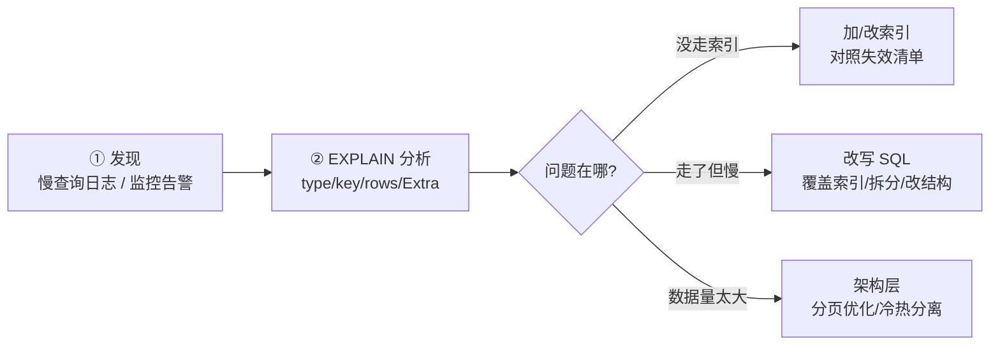

# 05 · 性能优化：慢查询定位与典型优化

一条原则贯穿全篇：**先定位，再优化**——没有 EXPLAIN 和慢查询日志的"优化"都是玄学。

## 优化定位链路（标准三步）



开启慢查询日志：

```sql
SET GLOBAL slow_query_log = ON;
SET GLOBAL long_query_time = 0.5;        -- 超过 0.5s 记录（生产常用 0.1~1s）
SET GLOBAL log_queries_not_using_indexes = ON;
```

线上更常用 **pt-query-digest** 分析慢日志，按"总耗时"聚合出 TOP SQL——单条慢不如聚合慢伤害大。

## 典型优化一：深分页（LIMIT 100 万, 10）

**为什么慢**：`LIMIT 1000000, 10` 要**真的取出前 1000010 行**再扔掉前 100 万——读 100 万行只为 10 行。

```sql
-- ❌ 3 秒+
SELECT * FROM t_post ORDER BY id LIMIT 1000000, 10;

-- ✓ 方案A：游标/键集分页（最优）——记住上一页最后的 id
SELECT * FROM t_post WHERE id > 1000000 ORDER BY id LIMIT 10;   -- 走索引直接定位，毫秒级
-- 前端改造成"下一页"模式（不再支持跳页），-feed 流（stage5/03）同款思路

-- ✓ 方案B：延迟关联（必须保留跳页时）——先用覆盖索引拿 10 个 id，再回表
SELECT p.* FROM t_post p
JOIN (SELECT id FROM t_post ORDER BY id LIMIT 1000000, 10) t ON p.id = t.id;
-- 子查询走覆盖索引只扫索引不回表，外层只对 10 行回表
```

**方案对比**：游标分页性能最优且天然防重复（Feed 流 stage5/03 用它）；延迟关联兼容现有跳页 UI。

## 典型优化二：JOIN 的两条铁律

1. **小表驱动大表**：`IN` 版的 `WHERE dept_id IN (SELECT id FROM dept WHERE ...)`，dept 小时先查全量 dept 再走 dept_id 索引——驱动表放 FROM 侧，被驱动表的**关联字段必须有索引**。
2. **JOIN 的字段类型/字符集一致**：隐式转换让索引失效（如 varchar 列 = int 值，或 utf8 vs utf8mb4 关联）。

MySQL 8.0.18+ 有 Hash Join 补齐无索引等值 JOIN，但**别依赖它**——关联字段建索引仍是第一法则。

## 典型优化三：count(*) 与大表统计

- `count(*)` ≠ `count(列)`：`*` 由优化器选最小的索引树扫（不会取值），性能最好——**count(*) 是标准写法，别用 count(1)/count(id) 较劲**
- 大表 count 慢的本质：InnoDB 的 MVCC 导致"同一时刻不同事务看到的行数不同"→ **必须真实扫**（MyISAM 无 MVCC 所以存了总数）
- 精确计数的替代：**计数表/Redis 计数**（写时 INCR，读时 O(1)——community 的阅读计数就是它）；Approx_count_distinct 级别的容忍 → HLL（stage5/07）

## 典型优化四：大表 DDL 与大事务

| 危险操作 | 风险 | 安全做法 |
|---------|------|---------|
| `ALTER TABLE` 加列（5.6 前锁全表） | 阻塞读写 | **Online DDL**（8.0 默认，ALGORITHM=INPLACE）或 gh-ost/pt-online-schema-change（影子表+触发同步+原子改名） |
| 大批量 UPDATE/DELETE（一次 100w 行） | 大事务：undo 膨胀、锁范围大、主从延迟 | **分批**：`LIMIT 1000` 循环 + 间隔 sleep |
| 一口气导千万数据 | 同上 + binlog 暴涨 | LOAD DATA / 分批插入 |

```sql
-- 分批删除模板（循环执行直到 affected_rows = 0）
DELETE FROM t_log WHERE created_at < '2025-01-01' LIMIT 1000;
-- 每批之间 sleep 100ms，把主从延迟控制在秒级
```

**"大事务拆小"与 MQ 教学的"大 Key 拆分"（stage3/04）是同一哲学：把一次性巨量操作切成可控的小片。**

## 优化检查清单（EXPLAIN 之外的工程视角）

- [ ] 该查的字段才查（禁 SELECT *，覆盖索引友好）
- [ ] JOIN 不超过 3 张表；关联字段有索引且类型一致
- [ ] 深分页：游标或延迟关联
- [ ] 批量操作分批 + 限速
- [ ] 监控慢查询日志水位 + `SHOW PROCESSLIST` 长事务
- [ ] 统计类计数走 Redis/计数表，不扫大表

## 面试问法

**Q: 千万级大表深分页怎么优化？**
A: LIMIT M,N 慢在扫掉并丢弃 M 行。方案A 键集分页：WHERE id > 上一页末尾 id LIMIT 10，走索引定位毫秒级，改造为游标翻页；方案B 延迟关联：子查询用覆盖索引取 10 个 id，外层再回表拿整行，兼容跳页 UI。同时把"排序字段+索引"对齐，避免 filesort。

**Q: 千万行大表怎么安全加字段/删数据？**
A: DDL 用 Online DDL（INPLACE）或 gh-ost 影子表方案（建影子表同步数据+原子改名，可控速率可暂停）；批量删除按主键分批 LIMIT+sleep，控制主从延迟；一切原则=大事务拆小。

---

**下一篇**：[06-实战架构](06-实战架构.md)——读写分离、分库分表与高可用选型。
