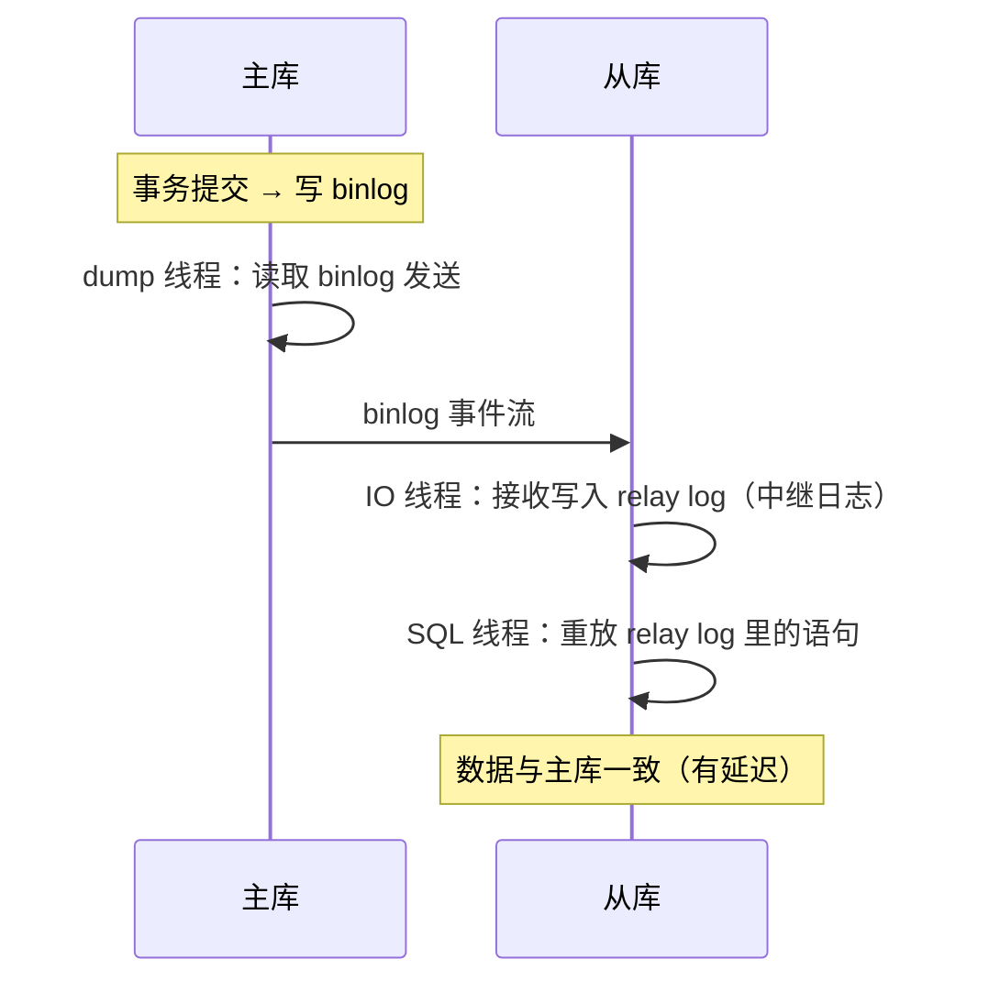

# 07 · 主从复制与高可用：原理篇

[06-实战架构](06-实战架构.md)讲了"怎么选"，本篇讲**复制是怎么工作的**——理解原理才能理解主从延迟为什么发生、切换为什么丢数据。

## 复制原理：三个线程的接力



| 线程（主库侧 1 个） | 线程（从库侧 2 个） | 职责 |
|---------------------|---------------------|------|
| dump 线程 | IO 线程 | 主库 binlog → 从库 relay log |
| — | SQL 线程 | 重放 relay log 里的变更 |

- 主库每事务写 binlog；从库 IO 线程拉取写入本地 **relay log**（中继日志）；SQL 线程重放
- **异步复制**：主库提交不等从库——这就是主从延迟与切换丢数据的根源

## 复制模式三档

| 模式 | 机制 | 性能 | 一致性 |
|------|------|------|--------|
| 异步（默认） | 主库提交即返回，异步传从库 | 最好 | 切换可能丢尾部 |
| **半同步 semisync** | 至少 1 个从库确认收到才返回客户端 | 折中 | 折中 |
| 组复制 MGR | Paxos 多数派确认 | 较差 | 强 |

半同步也不是万无一失：确认的是"**收到** binlog"不是"**重放完成**"，且确认超时会自动降级为异步。

## 主从延迟：成因与治理

**成因**：
1. **单线程回放**（5.7+ 多线程按库/按事务组并行，但热点表仍可能追不上）
2. 从库机器配置低 / 大事务（一次 UPDATE 100w 行，主库执行 1 分钟，从库重放也要 1 分钟——**大事务是延迟放大器**）
3. 从库上跑了分析查询抢资源

**治理**：
- 大事务拆小（分批 UPDATE——性能优化篇的大事务纪律）
- 并行复制（`slave_parallel_workers` + `slave_parallel_type=LOGICAL_CLOCK`）
- 监控 `Seconds_Behind_Master` 告警
- **业务层**：写后读走主库（会话粘性——实战架构篇的四解）

## GTID：全局事务标识（5.6+）

每个事务有全局唯一 ID（`UUID:序号`），主从切换/搭建复制不再需要人工找 binlog 位点——**从库告诉主库"我执行到哪个 GTID 了"，主库自动补发缺失的**。运维大幅简化（老方案：file + position 手工对齐易错）。

## 高可用方案对比（原理视角）

| 方案 | 原理 | RTO 恢复时间 | 一致性 |
|------|------|-------------|--------|
| 主从+人工切换 | — | 分钟~小时（人到位） | 可能丢尾部 |
| **MHA/Orchestrator** | 监控+自动 failover 选最全新主 | 10~30s | 可能丢尾部 |
| **MGR 组复制** | 多数派 Paxos，强同步 | 秒级 | **不丢**（代价：写性能降） |
| 云 RDS 高可用版 | 厂商托管（同原理） | 秒~30s | 半同步/多数派 |
| **PolarDB/TiDB** | 共享存储/分布式 | 秒级 | 强 |

## 读写分离落地（代码层）

你项目的 SQL 直连主库。接入读写分离通常三种姿势：

| 姿势 | 说明 | 代表 |
|------|------|------|
| 中间件代理 | 应用连代理（ProxySQL/MyCat），代理路由主从 | 对应用透明 |
| **SDK 路由** | ShardingSphere-JDBC 在 JDBC 层路由读写 | 应用内配置即可 |
| 手写多数据源 | AbstractRoutingDataSource + AOP 按注解路由 | 轻量自研 |

**强制走主的场景**（一致性要求高于延迟容忍）：写后立刻读、事务内全部读、`Hint` 强制主库注解。

## 半同步复制参数（一主一从开启半同步）

```sql
-- 主库
INSTALL PLUGIN rpl_semi_sync_master SONAME 'semisync_master.so';
SET GLOBAL rpl_semi_sync_master_enabled = 1;
SET GLOBAL rpl_semi_sync_master_timeout = 1000;   -- 1 秒等不到从库 ACK 则降级异步（防阻塞）

-- 从库
INSTALL PLUGIN rpl_semi_sync_slave SONAME 'semisync_slave.so';
SET GLOBAL rpl_semi_sync_slave_enabled = 1;
```

## 面试问法

**Q: 主从复制的原理？主从延迟怎么解决？**
A: 主库 dump 线程发 binlog → 从库 IO 线程写 relay log → SQL 线程重放。异步复制是延迟与切换丢数据的根源。延迟治理四层：①大事务拆小（延迟放大器）；②并行复制（5.7+ LOGICAL_CLOCK）；③监控 Seconds_Behind_Master 告警；④业务层写后读走主/会话粘性。半同步复制让至少一个从库确认收到才返回客户端，折中一致性与性能。

**Q: 高可用方案怎么选？**
A: 主从+MHA/Orchestrator 自动 failover（10~30s，可能丢尾部）→ MGR 组复制（Paxos 强一致，写性能降）→ 云 RDS 托管（免运维）→ PolarDB/TiDB（大容量分布式）。选型看：一致性要求（能否容忍丢尾部）、运维能力（自建 vs 云托管）、数据规模（单机够用则主从+哨兵思想即可）。

---

**MySQL 模块完成** ✅（7/7）。回 [README](../README.md)。
