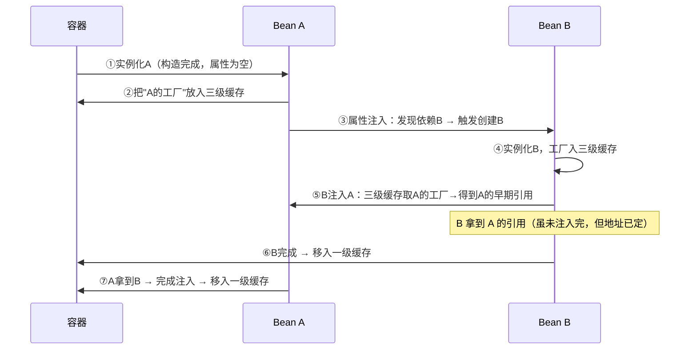

# 01 · IoC 容器与 Bean 生命周期

> 🎬 **配套交互演示**：[diagrams/spring-bean-lifecycle.html](../../diagrams/spring-bean-lifecycle.html)——十一步生命周期逐步走 + A↔B 循环依赖的三级缓存流转动画（含"构造器注入无解"反例）。

IoC（控制反转）：对象的创建与依赖装配交给容器管理——你声明"我需要什么"（@Autowired），容器负责"造出来+塞进去"。本篇把**Bean 从出生到死亡的全流程**和**循环依赖的三级缓存**讲透。

## 容器启动与 Bean 定义

```
启动 → 扫描（@ComponentScan/自动装配）→ 解析成 BeanDefinition（类的"配方"，不是实例）
     → 注册到 BeanDefinitionMap → 逐个按配方 instantiate Bean
```

**BeanDefinition 与 Bean 分离**是理解扩展的钥匙：`BeanFactoryPostProcessor`（如 PropertySourcesPlaceholderConfigurer 解析 ${} 占位符）在**实例化前**修改配方；`BeanPostProcessor` 在**实例化后**加工成品。

## Bean 生命周期十一步（背这张流程图）

```mermaid
flowchart TD
    A["① 实例化（构造方法/工厂方法）"] --> B["② 属性注入 populateBean<br/>@Autowired/@Value"]
    B --> C["③ Aware 回调<br/>BeanNameAware / ApplicationContextAware..."]
    C --> D["④ BeanPostProcessor#postProcessBeforeInitialization"]
    D --> E["⑤ 初始化：@PostConstruct →<br/>InitializingBean#afterPropertiesSet → init-method"]
    E --> F["⑥ BeanPostProcessor#postProcessAfterInitialization<br/>⭐ AOP 代理在这里生成！"]
    F --> G["⑦ 使用（singleton 常驻容器）"]
    G --> H["⑧ 销毁：@PreDestroy →<br/>DisposableBean#destroy → destroy-method"]
    style F fill:#78350f,color:#fde68a
    style A fill:#164e63
    style E fill:#14532d
```



**两个最重要的位置**：

- **⑥ postProcessAfterInitialization**：AOP 代理就是在这里由 `AnnotationAwareAspectJAutoProxyCreator` 生成的（返回代理对象替换原始 Bean）——`@Transactional`、`@Async` 的魔法源头
- **⑤ @PostConstruct**：mq-mall 秒杀的 Redis 库存初始化就在这里执行（容器就绪前最后的机会做预热）

```java
@Component
public class MyBean implements InitializingBean, DisposableBean, BeanNameAware {
    @Autowired private SomeService service;          // ② 属性注入
    private String name;

    public MyBean() { log("① 构造"); }               // ① 实例化

    @Override public void setBeanName(String n) {    // ③ Aware（感知容器）
        this.name = n; log("③ BeanNameAware");
    }
    @PostConstruct public void init0() { log("⑤a @PostConstruct"); }        // ⑤ 最先
    @Override public void afterPropertiesSet() { log("⑤b afterPropertiesSet"); }
    @PreDestroy public void cleanup() { log("⑧ @PreDestroy"); }
}
```

**顺序**：构造 → 注入 → Aware → BeanPostProcessor前 → @PostConstruct → afterPropertiesSet → 自定义 init-method → BeanPostProcessor后 → 使用 → @PreDestroy → destroy-method。

## 循环依赖与三级缓存（Spring 面试第一难题）

A 依赖 B，B 又依赖 A——怎么解决"鸡生蛋"问题？Spring 用**三个 Map**：

```java
singletonObjects          // 一级缓存：成品 Bean（完全初始化）
earlySingletonObjects     // 二级缓存：半成品/早期引用（已实例化未注入完）
singletonFactories        // 三级缓存：ObjectFactory 工厂（能产出早期引用，含 AOP 判断）
```

### 流转过程（A↔B 循环依赖，假设都无 AOP）



### 为什么需要三级缓存而不是两级？

答案与 **AOP** 有关：代理对象要在"有人依赖我之前"就确定。三级缓存放的是 **ObjectFactory**——只有**真的被别人依赖时**才调用工厂，工厂里判断"我需要代理吗"→ 提前生成代理放入二级缓存。效果：**正常情况下代理仍在初始化后生成（⑥），只有循环依赖时才提前**——既支持循环依赖，又不破坏"代理后置生成"的设计原则。

> [!CAUTION]
> **构造器注入的循环依赖无解**——实例化还没完成，连早期引用都暴露不了。报 `BeanCurrentlyInCreationException`。解法：`@Lazy` 注入（注入一个代理，首次使用才真正取 Bean），或重构设计消除环。

### 其它"无解"的循环依赖场景

| 场景 | 能否解决 | 原因 |
|------|---------|------|
| 字段注入/setter 注入 | ✅ 三级缓存 | 实例化后即可暴露引用 |
| 构造器注入 | ❌ | 实例化本身就是死结 |
| prototype 作用域 | ❌ | 不走缓存（非 singleton） |

## 与你项目的连接

| 现象 | 本篇解释 |
|------|---------|
| mq-mall `SeckillOrderTxWorker` 拆独立 bean | @Transactional 的 AOP 代理在⑥生成；自调用不走代理（下一章展开） |
| community 启动日志一堆 `BeanPostProcessor` | 都是③~⑥阶段挂进来的加工器 |
| `@PostConstruct` 里初始化秒杀库存 | ⑤ 阶段——容器就绪前的最后预热时机 |
| 启动报 `BeanCurrentlyInCreationException` | 构造器循环依赖 → @Lazy |

## 面试问法

**Q: Bean 生命周期？**
A: 实例化→属性注入→Aware 回调→BeanPostProcessor 前置→初始化（@PostConstruct→afterPropertiesSet→init-method）→BeanPostProcessor 后置（**AOP 代理在此生成**）→使用→销毁（@PreDestroy→destroy-method）。扩展点：BeanFactoryPostProcessor 改配方在前，BeanPostProcessor 加工在后。

**Q: 循环依赖怎么解决？为什么三级缓存？**
A: singleton 字段注入的循环依赖靠三级缓存（成品/早期引用/工厂）。工厂延迟决定"是否提前 AOP 代理"——保证正常场景代理仍后置生成。构造器注入与 prototype 无解，用 @Lazy 或重构。追问方向：为什么不用两级（无法表达"提前代理的延迟判断"）。

---

**下一篇**：[02-AOP 原理](02-AOP原理.md)——代理是怎么织入的。
