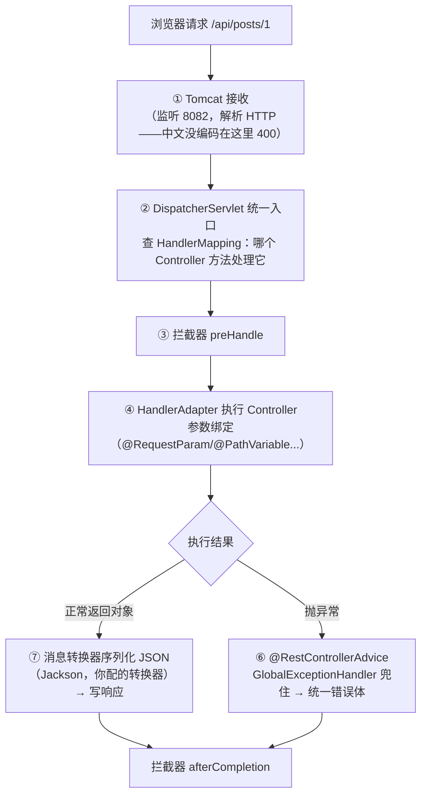

# 04 · SpringMVC 请求流程

一次 `GET /api/posts/1` 从 Tomcat 到你的 Controller 再返回 JSON，中间发生了什么。理解流程 = 理解参数绑定规则、拦截器时机、全局异常处理为什么能生效。

## 请求处理流程（五步）



**两个你已经在教学里见过的现象，在这一页找到解释**：

1. **中文参数 400**（踩坑实录坑十一）：发生在 ① Tomcat 解析 HTTP 行——请求根本没到 ② DispatcherServlet，Spring 无感知，所以业务日志一片空白
2. **`/actuator/health` 是 404**：actuator 的端点也注册在 DispatcherServlet 里，没引依赖自然 404

## 参数绑定的六种来源（对照 community 的 DemoController）

| 注解 | 来源 | 例子 |
|------|------|------|
| `@RequestParam` | 查询串/表单体 | `?title=x`（中文要 `--data-urlencode`） |
| `@PathVariable` | 路径占位符 | `/posts/{id}` |
| `@RequestBody` | 请求体 JSON | POST JSON（配 Jackson 转换器） |
| `@RequestHeader` | 请求头 | `Authorization: Bearer xxx` |
| 无注解 POJO | 查询串/表单按字段名装 | `?name=x&age=1` → User 对象 |
| `MultipartFile` | 文件上传 | 头像/附件 |

**GET 中文 400 的真相**（[踩坑实录坑十一](../../mq/踩坑实录-完整复盘.md)）：`?title=中文` 的原始字节不符合 RFC 3986，Tomcat 在 ① 直接拒绝；`--data-urlencode` 走表单体则绕开——**编码问题发生在传输层，不在 Spring**。

## 拦截器 vs 过滤器（对比表）

| | Filter 过滤器 | HandlerInterceptor 拦截器 |
|--|--------------|--------------------------|
| 归属 | Servlet 规范（Tomcat 层） | Spring MVC 层 |
| 时机 | DispatcherServlet **之前/之后** | ③ preHandle → 执行 → afterCompletion |
| 能否注入 Spring Bean | 不方便（容器未完全就绪时） | ✅ 直接注入 |
| 能拿到"哪个 Controller 方法" | ❌ | ✅（HandlerMethod） |
| 典型用途 | 编码、全局 XSS 过滤 | 登录态校验、traceId MDC 注入、接口权限 |

**登录校验用拦截器**（能拿 Bean、能识别方法）；community 教学版用"每个接口传 token"简化，生产版就是拦截器统一校验 token → ThreadLocal 绑定用户。

## 全局异常处理为什么能兜住一切

```java
@RestControllerAdvice
public class GlobalExceptionHandler {
    @ExceptionHandler(BizException.class)
    public ApiResponse<Void> biz(BizException e) { return ApiResponse.error(400, e.getMessage()); }

    @ExceptionHandler(Exception.class)
    public ApiResponse<Void> unknown(Exception e) { return ApiResponse.error(500, "系统繁忙"); }
}
```

原理：Controller 抛出的异常被 `ExceptionHandlerExceptionResolver` 捕获 → 匹配 `@ExceptionHandler` → 返回值当响应体。**所以业务代码里可以放心 throw，把"错误怎么展示"统一交给 advice**——这也解释了 community 的 `sendInTransaction 必须在事务内调用` 为什么能变成页面上的优雅错误提示。

> [!WARNING]
> 全局异常处理兜不住**进入 Spring 之前**的错误：Tomcat 解析 400（坑十一）、SSL 握手失败、超时——这些在 access log / 网关层看。

## 统一响应的返程

```java
record ApiResponse<T>(int code, String msg, T data) { static ok/error }
```

Controller 返回对象 → Jackson 按 `ApiResponse` 结构序列化。注意 `Boolean.TRUE.equals(first)` 那次签到 bug——**返回给前端的文案语义要经过测试**，接口层是用户感知的第一现场。

## 面试问法

**Q: SpringMVC 一次请求的流程？**
A: Tomcat 接收 → DispatcherServlet 查 HandlerMapping 定位到 Controller 方法 → 拦截器 preHandle → HandlerAdapter 完成参数绑定并执行 → 返回值经消息转换器（Jackson）序列化写响应；异常走 @RestControllerAdvice 统一处理；最后拦截器 afterCompletion。参数来源六种：RequestParam/PathVariable/RequestBody/Header/表单POJO/MultipartFile。

**Q: 拦截器和过滤器的区别？**
A: Filter 属于 Servlet 规范、在 DispatcherServlet 之外，做编码/XSS 等与 Spring 无关的处理；Interceptor 属于 Spring MVC，在 DispatcherServlet 内，能注入 Bean、能识别目标方法（HandlerMethod），适合登录校验/traceId/权限。执行顺序：Filter 前 → Interceptor preHandle → Controller → Interceptor afterCompletion → Filter 后。

---

**下一篇**：[05-常用扩展机制](05-常用扩展机制.md)。
