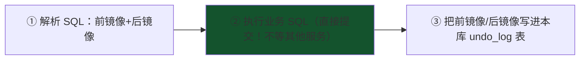

# 06 · Seata：分布式事务的第四种答案

跨服务的数据库操作怎么保证一致性？mq 教学 stage4/03 给过三个答案（本地消息表 / RocketMQ 事务消息 / MQ 最终一致），**Seata 是第四个**：把"分布式事务"包装成"像本地事务一样用"。

## 四种方案定位表（先放全景再深入）

| 方案 | 一致性 | 侵入性 | 性能 | 适用 |
|------|--------|--------|------|------|
| 本地消息表 + MQ | 最终一致 | 中（写消息表） | 好 | **大多数场景（mq-mall/community 已实现）** |
| RocketMQ 事务消息 | 最终一致 | 低 | 好 | 已用 RocketMQ 的团队 |
| **Seata AT** | **接近强一致** | **极低（无侵入）** | 中 | 同步链路短事务 |
| TCC | 强一致 | 高（三个方法手写） | 好 | 资金类核心链路 |

## Seata AT 模式：两阶段 + undo_log（核心机制）

**角色**：TC 事务协调器（独立服务 seata-server，管全局事务状态）/ TM 事务发起方 / RM 资源管理方（各参与服务的数据库）。

**一阶段（每个参与服务）**：



**关键：一阶段就本地提交了**——不长期持有全局锁（对比 XA 两阶段全程锁资源）。代价是：提交后若全局需要回滚，靠 undo_log 反向补偿。

**二阶段**：

- 全局提交 → **异步删除 undo_log**（几乎零成本）
- 全局回滚 → 按 undo_log 的前镜像**生成反向 SQL 补偿执行**（`UPDATE points SET x=旧值 WHERE id=? AND 后镜像匹配`）

```sql
-- undo_log 表（Seata 自动维护）存储内容示意
branch_id | xid(全局事务) | rollback_info(前镜像JSON+后镜像JSON) | log_status
```

**防脏写**：回滚前校验"后镜像与当前数据一致"（别人没改过）——不一致则报脏写需人工处理。**这就是数据库层面的乐观锁**（并发篇 04 的 CAS 思想又一次出现）。

## 使用方式（侵入性低到惊人）

```java
// 发起方方法上：一个注解
@GlobalTransactional
public void createOrder() {
    orderService.create();            // 服务A：INSERT 订单（RM，生成 undo_log）
    stockService.deduct();            // 服务B：Feign 调用扣库存（RM，生成 undo_log）
    pointsService.add();              // 服务C：Feign 调用加积分
    // 任何一步异常 → TC 通知所有 RM 用 undo_log 反向补偿 → 全局回滚
}
```

**对比本地消息表**：本地消息表是"发事件让下游各自补偿（最终一致，秒级延迟）"；Seata AT 是"全局协调、反向 SQL 回滚（准实时强一致，有全局锁开销）"。

## 四种模式（Seata 自己也有选型）

| 模式 | 机制 | 侵入性 | 场景 |
|------|------|--------|------|
| **AT** | 自动生成反向补偿（上面） | 极低 | 大多数（默认） |
| TCC | 手写 Try/Confirm/Cancel 三方法 | 高 | 资金核心（Try 预留资源：冻结额度） |
| SAGA | 长流程状态机+补偿服务 | 中 | 长流程/跨企业 |
| XA | 数据库原生两阶段 | 低 | 强一致但性能差（全程锁资源） |

## 与 MQ 方案的终极对比（本模块收束）

```
需要"准实时强一致"、链路短（2~3 个服务同步调用）→ Seata AT
可以"最终一致"（秒级延迟无感）、链路长/异步 → MQ 事务消息/本地消息表（你的 community 方案）
资金类强一致且高并发 → TCC
```

**社区现状的诚实判断**：很多大厂最终一致方案为主（MQ），强一致点用 TCC/Seata AT 局部使用——**没有银弹，按一致性需求分级**（与 stage3/01 "可靠性分级"原则一致）。

## 面试问法

**Q: Seata AT 模式的原理？和本地消息表怎么选？**
A: AT = 两阶段+undo_log。一阶段：解析 SQL 记录前后镜像写入本库 undo_log，业务 SQL 直接本地提交（不长时间持锁）；二阶段：全局提交则异步删 undo_log，回滚则按前镜像生成反向 SQL 补偿（回滚前校验后镜像防脏写——乐观锁思想）。侵入性极低（@GlobalTransactional 一个注解）。对比本地消息表：AT 准实时强一致但全局锁有性能开销、支持服务少；本地消息表最终一致、简单可控——同步短链路选 AT，异步长链路选 MQ 方案，资金核心选 TCC。

---

**微服务全家桶模块完成** ✅（7/7，含 [07-XXL-Job 分布式任务调度](07-XXL-Job分布式任务调度.md)）。回到 [java-core README](../README.md) 查看总进度。
