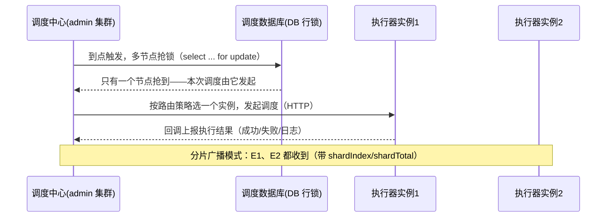

# 07 · XXL-Job：分布式任务调度

你项目里到处是 `@Scheduled`：mq-mall 的 `OrderSweepJob`（扫超时单）、`SendRetryJob`（补偿重发）、community 的 `CounterFlushJob`（计数刷库）。**单机没问题，多实例部署就出事**——这篇解决它。

## 场景引入：@Scheduled 的多实例事故

```java
// mq-mall compensation/OrderSweepJob.java
@Scheduled(fixedDelay = 20_000)
public void sweepExpiredOrders() { ... }   // 扫 30 分钟未支付订单 → 关单+回库存
```

部署 2 个实例时：**两台机器各自跑一份** → 同一订单被两台同时关单（回库存×2）、CPU 空转浪费一倍。❌ 临时方案是加分布式锁（redis stage3/03），但锁只解决"重复跑"，解决不了：**失败重试、执行记录可视、任务分片、动态增删任务**——这些是调度平台的活。

> **XXL-Job 一句话**：调度中心（统一编排"谁在几点跑什么"）+ 执行器（你业务进程里的 JobHandler）。**调度与执行分离**——和"网关与业务服务分离"同款思想。

## 如何使用（Spring Boot 3 接入）

```
① 部署调度中心：xxl-job-admin（自带建表 SQL，一个 jar 起来）
② 业务进程加执行器依赖：
   com.xuxueli:xxl-job-core + 配置 admin 地址、appname、端口
③ 写 JobHandler：
```

```java
@Component
public class OrderSweepJobHandler {

    @XxlJob("orderSweepJob")
    public void sweep() {
        // 原来的 @Scheduled 方法体原样搬进来
        orderService.closeExpiredOrders();
    }
}
// 然后在调度中心网页上：新建任务 → JobHandler 填 orderSweepJob → Cron 表达式 → 启动
```

**分片广播**（多实例并行处理大数据量——核心考点）：

```java
@XxlJob("orderSweepShardingJob")
public void sweepSharding() {
    int shardIndex = XxlJobHelper.getShardIndex();   // 当前是第几片（0 起）
    int shardTotal = XxlJobHelper.getShardTotal();   // 总共几片 = 执行器实例数
    // 按 id 取模分片：每个实例只处理自己那份，互不重叠
    orderService.closeExpiredOrdersByMod(shardIndex, shardTotal);
    // SQL: WHERE id % #{shardTotal} = #{shardIndex} AND status = 'UNPAID' ...
}
```

## 原理：调度中心怎么保证不重复调度



| | @Scheduled | Quartz 集群 | XXL-Job |
|--|-----------|------------|---------|
| 多实例重复跑 | ❌ 各跑各的 | ✅ DB 锁抢占 | ✅ 调度中心统一发 |
| 动态增删任务 | ❌ 改代码重启 | 界面一般 | ✅ 控制台点一下生效 |
| 失败重试/告警 | ❌ 无 | 弱 | ✅ 重试次数+邮件告警+日志可视 |
| 分片并行 | ❌ 无 | ❌ 无 | ✅ **分片广播**，实例数=并行度 |
| 定位 | 单机玩具/单实例 | 老牌但重 | 国内主流（美团/滴滴系） |

**路由策略**：轮询/随机/故障转移（先第一个，失败换下一个）/分片广播……"故障转移"是**执行器高可用**的关键——某台挂了任务自动换机执行。

## 问题与解法

- **任务执行时间超过调度间隔**？→ 阻塞策略三选一：单机串行（默认，排队）、丢弃后续调度（适合对账类，宁可少跑不堆积）、覆盖之前调度（慎用）。mq-mall 的 `SendRetryJob` 该选**丢弃**——重发任务重叠跑只会放大消息重复。
- **分片不均（数据倾斜）**？→ 按 `id % shardTotal` 分片是均匀的；按业务维度（如门店）分片会倾斜——热点维度单独拆任务。
- **任务跑一半实例宕机**？→ 故障转移路由 + 失败重试次数（调度中心可配）；**JobHandler 自身要幂等**（关单前再查一次状态）——消息幂等（mq stage3/02）同款防御。
- **和延迟任务的分工**？→ XXL-Job 管**周期性**任务（每 20s 扫单）；**精确一次性**延迟（这单 10:30:00 关）用延迟队列（mq stage4/02）。❌ 不要用 XXL-Job 每秒轮询做延迟队列——扫表低效又不精确。

## 高并发实战：百万级数据迁移

需求：老表 5000 万行迁新表。单机跑 2 小时且内存吃紧 → 分片广播横向扩：

```
调度中心建任务：路由=分片广播，Cron 手动触发
执行器 10 个实例自动就位 → shardTotal=10，每实例领 1/10 数据
单实例内部再分页批读（LIMIT 游标分页，并发篇 05 的线程池并行批次）
失败分片自动重试，只补失败的片；控制台实时看每片日志
```

社区 `HeatDecayJob`（每小时热度衰减）这类轻任务不值得上 XXL-Job——**单实例或加一把 Redis 锁就够**；调度平台是给"多实例 + 要运维"的任务用的，别为了技术栈上工具。

## 面试问法

**Q: XXL-Job 的原理？和 @Scheduled 区别？**
A: 调度与执行分离。调度中心集群通过 **DB 行锁抢占**保证一次触发只有一个节点发起；执行器是业务进程内嵌的 handler，HTTP 回调上报结果。@Scheduled 是单机线程池调度，多实例重复执行、无重试告警、不能动态管理。XXL-Job 补齐：统一调度不重复、控制台动态增删、失败重试+告警、**分片广播**（实例数=并行度，`id % shardTotal = shardIndex` 分数据处理）、故障转移路由。

---

**下一篇**：本模块完结。回到 [java-core README](../README.md)，或看 [05 篇 Sentinel](05-Sentinel熔断限流.md) 复习限流熔断。
