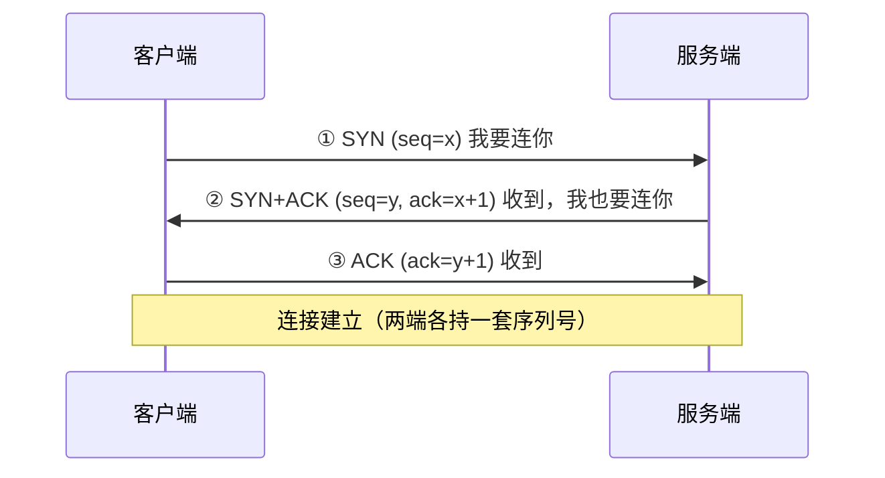
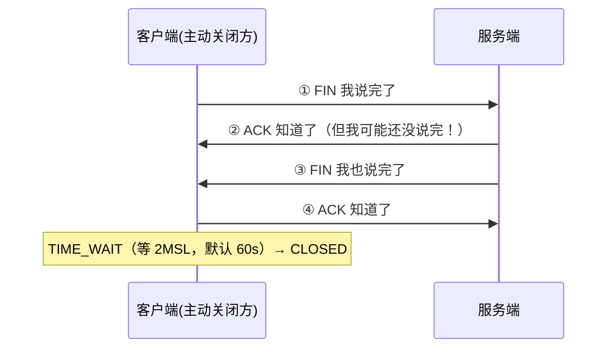

# 01 · TCP：三次握手、四次挥手与 TIME_WAIT

> 🎬 **配套交互演示（容易看懂版）**：[diagrams/tcp-handshake.html](../../diagrams/tcp-handshake.html)——打电话比喻：三个气泡看懂三次握手，四个气泡看懂四次挥手和 TIME_WAIT 的由来。

所有后端连接问题（连接池满、TIME_WAIT 爆、连接被重置——踩坑实录坑十二的底层）都回到 TCP 本身。

## 三次握手（为什么是三次）



**为什么不是两次**：② 如果算建立完成，一个**迷路的旧 SYN**（网络中迟到的重复包）到达服务端就会被"连接"，服务端白白建立连接等待——**两次无法防止历史连接初始化**。第三次 ACK 让客户端确认"双方收发能力都正常"且过滤旧连接。

**为什么不是四次**：② 的 SYN 和 ACK 可以合并成一个包（服务端的"确认+发起"同时做）——三次是**信息充分的最小次数**。

## 四次挥手（为什么是四次）



**为什么挥手比握手多一次**：TCP 是全双工（两个方向独立）。收到 FIN 只说明"对方不再发送"，**自己可能还有数据没发完**——所以 ACK 和自己的 FIN 不能合并（数据发完才能 FIN）。握手的 SYN+ACK 能合并是因为建立时双方都还没数据。

### TIME_WAIT：主动关闭方的"漫长告别"

主动关闭方在发完最后一个 ACK 后等待 **2MSL**（报文最大生存时间 ×2，Linux 默认 60s）才真正关闭：

- **为什么等**：①确保最后的 ACK 能到达（丢了对方会重发 FIN，能再 ACK）②让本连接的旧报文在网络中自然消亡（防污染新连接）
- **症状**：高并发短连接客户端（压测机、爬虫）出现**大量 TIME_WAIT**（`netstat` 可见）——端口耗尽（默认 ~28k 个本地端口）导致无法建新连接

**处理顺序**（先客户端再内核）：

```
1. 应用层用长连接/连接池复用（根治——HTTP keep-alive、数据库连接池你已经全在用）
2. 内核参数缓解：net.ipv4.tcp_tw_reuse=1（客户端复用 TIME_WAIT 端口）
   —— 服务端的 TIME_WAIT 是"被动的"无法绕过，唯有让客户端别频繁断连
```

## TCP vs UDP：可靠与实时的取舍

| | TCP | UDP |
|--|-----|-----|
| 连接 | 面向连接（握手） | 无连接 |
| 可靠 | 确认重传/有序/不丢 | 尽力而为，可能丢/乱 |
| 速度 | 略慢（确认+拥塞控制） | 快（无这些机制） |
| 场景 | HTTP/数据库/MQ | DNS/视频直播/游戏帧/IoT |
| "消息"概念 | 字节流（**无边界**→粘包拆包问题，网络04 篇） | 数据报（天然有边界） |

## 与后端开发的三个连接

1. **连接池 = TCP 长连接复用**：数据库连接池（Hikari）、HTTP keep-alive、Redis/RabbitMQ 长连接——全部在减少握手挥手开销（每次握手 1 RTT+TLS 更久）
2. **连接被重置**（踩坑实录坑十二）：代理截断 TCP → `Connection closed`；TCP 层看是 RST 包
3. **epoll**（r-stage2/01）管理的就是这些 TCP 连接的 socket 事件

## 面试问法

**Q: 为什么握手三次挥手四次？**
A: 握手三次是信息充分的最小次数——两次无法防止"历史 SYN 迷路包"初始化旧连接，且服务端 SYN+ACK 可合并；挥手四次因为 TCP 全双工，收到 FIN 只表示对方不发，自己数据发完才能发 FIN，ACK 与 FIN 无法合并。TIME_WAIT 等 2MSL：保证最后 ACK 可达 + 旧报文消亡。

**Q: 线上大量 TIME_WAIT 怎么办？**
A: 根因是高并发短连接（客户端主动断）。根治=应用层连接池/长连接复用；缓解=客户端开 tcp_tw_reuse；监控端口耗尽告警。服务端 TIME_WAIT 无法绕过（被动的），本质还是要让连接被复用。

---

**下一篇**：[02-HTTP协议演进与HTTPS](02-HTTP协议演进与HTTPS.md)。
