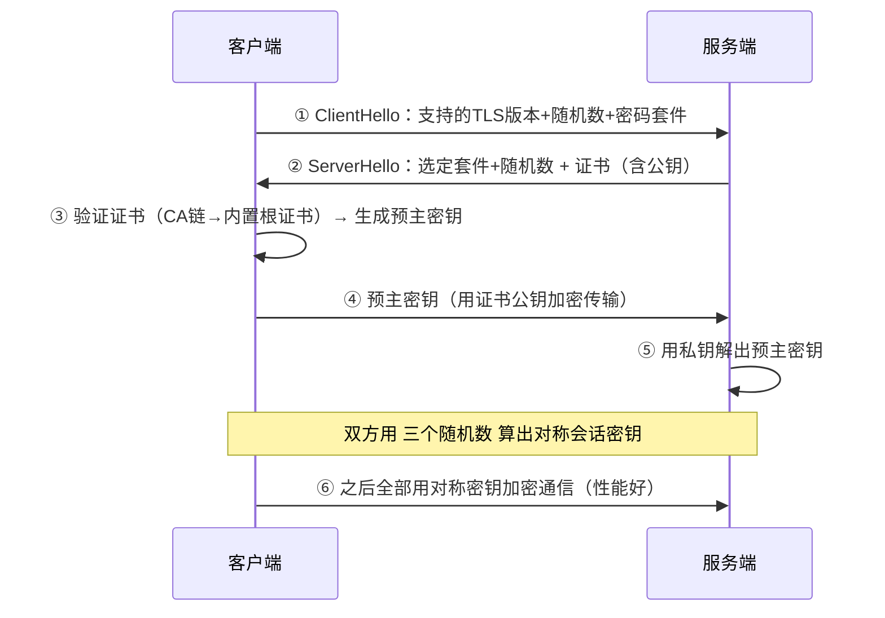

# 02 · HTTP 演进与 HTTPS

> 🎬 **配套交互演示（容易看懂版）**：[diagrams/http-journey.html](../../diagrams/http-journey.html)——寄快递比喻：8 站路径动画演示“输入网址后发生了什么”（写快递单→查通讯录→接电话→上锁→寄出→拆信）。

后端每天都在跟 HTTP 打交道。考点：各版本演进的原因、HTTPS 握手、状态码与缓存头。

## 版本演进（每个版本解决前代的一个痛）

| 版本 | 解决什么 | 关键特性 | 遗留痛点 |
|------|---------|---------|---------|
| 1.0 | — | 一请求一连接（每次握手+TLS） | 连接开销巨大 |
| 1.1 | 连接复用 | **keep-alive 长连接**、管线化、Host 头 | **队头阻塞**（前一个响应没完，后面的排队）；文本冗余头 |
| **2** | 1.1 的队头阻塞 | **多路复用**（一个 TCP 连接上并发多个流）、头部压缩 HPACK、二进制分帧 | TCP 层的队头阻塞仍在（丢包全体等待） |
| **3** | 2 的 TCP 队头阻塞 | 改用 **QUIC（基于 UDP）**，连接迁移（换网络不断线）、0-RTT | 部署/穿透尚未普及 |

**2 的多路复用示意**（理解与 1.1 的区别）：

```
1.1：请求A ████ → 请求B → 请求C        串行（或 pipeline 但响应仍排队）
2：  连接 ████████████████（一条 TCP）
     流A ▸▸▸  流B ▸▸▸  流C ▸▸▸          帧交错并发，互不阻塞
```

## HTTPS = HTTP + TLS：握手过程（面试核心）



**两个考点**：

1. **非对称只用来"交换密钥"，数据传输用对称加密**——非对称慢百倍，对称快但密钥怎么安全送达？→ 用非对称保护密钥交换。
2. **证书验证链**：服务器证书 → 中间 CA → 根 CA（浏览器内置）→ 任一环不信任则告警。这也解释了自签证书为什么浏览器报警。

## 状态码：后端必须精确使用的十个

| 码 | 含义 | 你的项目场景 |
|----|------|-------------|
| 200 | 成功 | — |
| 301/302 | 永久/临时重定向 | 登录跳转 |
| 304 | 缓存有效（见下） | 静态资源 |
| **400** | 请求语法错误 | 中文没编码（踩坑实录坑十一：Tomcat 直接拒） |
| 401 | 未认证（token 无效） | 登录过期 |
| 403 | 已认证但无权限 | 越权访问 |
| 404 | 资源不存在 | 幽灵进程占端口时的诡异表现（踩坑实录） |
| 429 | 太多请求 | 网关限流（秒杀②层拒绝） |
| 500 | 服务端异常 | GlobalExceptionHandler 兜底 |
| 502/504 | 网关收到坏响应/上游超时 | 下游挂了/超时——**排障时区分 502(挂) vs 504(慢)** |

## 缓存头：浏览器缓存的控制协议

```
第一次响应：Cache-Control: max-age=3600, ETag: "abc123"
浏览器再次请求：If-None-Match: "abc123"
服务端比对：资源没变 → 304 Not Modified（不传 body，省流量）
资源变了 → 200 + 新内容 + 新 ETag
```

- `Cache-Control: no-cache` = 可以缓存但每次要验证（**不是不缓存**！常见误读）
- `no-store` 才是真不缓存
- 与 Redis 缓存的分工：浏览器缓存挡浏览器↔网关流量，Redis 挡应用↔DB 流程——**每层缓存有自己的协议**（多级缓存 stage3/01）

## 面试问法

**Q: HTTP 1.1/2/3 的区别？**
A: 1.1 引入 keep-alive 长连接但有队头阻塞（HTTP 层串行）；2 多路复用（二进制分帧，一条 TCP 并发多流）+HPACK 头压缩，但 TCP 丢包仍阻塞所有流；3 改用 QUIC（UDP）解决 TCP 队头阻塞+连接迁移+0-RTT。演进主线：让"一条连接上的并发"越来越彻底。

**Q: HTTPS 握手过程？为什么又用非对称又用对称？**
A: TLS 握手交换随机数+证书验证+非对称加密传输预主密钥 → 双方算出对称会话密钥 → 后续对称加密。非对称解决"密钥怎么安全送达"，对称负责数据传输性能。证书链验证保证"公钥确实是对方的"（防中间人）。

---

**下一篇**：[03-IO模型演进](03-IO模型演进.md)。
