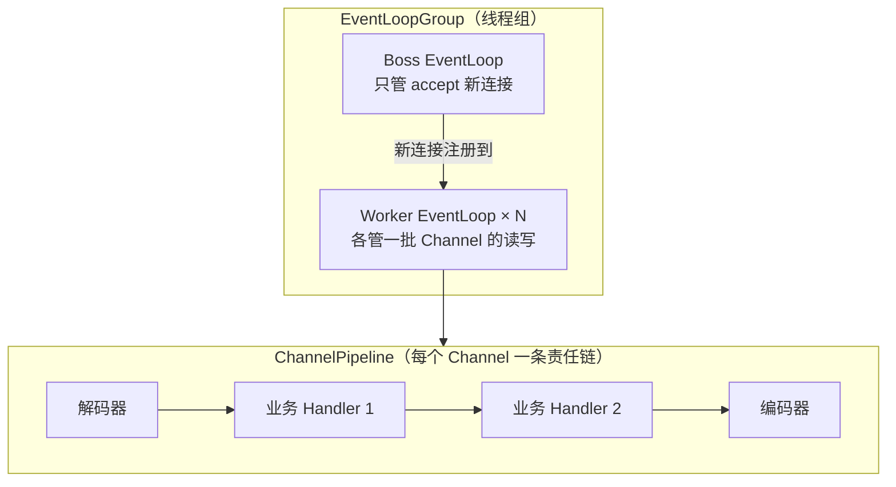

# 05 · Netty 入门：Java 高性能网络编程的事实标准

[IO 模型演进](03-IO模型演进.md)篇讲到了 NIO 和 epoll——本篇讲 **Netty**：把裸 NIO 封装成好用框架的工业级实现，Dubbo/RocketMQ/Elasticsearch/gRPC-Java/Spring WebFlux 底层全是它。

## 裸 NIO 的痛（为什么需要 Netty）

裸 `Selector/Channel/Buffer` 直接用有四大痛点：

| 痛点 | 说明 |
|------|------|
| API 反人类 | Buffer 的 flip/clear/rewind 三指针操作易错 |
| 空轮询 bug | JDK epoll 空轮询导致 CPU 100% 的已知 bug，需自行 hack |
| 断线重连、心跳 | 全要自己写 |
| **拆包粘包** | TCP 字节流无边界，半包/粘包处理全要自己写 |

**Netty 的解法**：事件循环（EventLoop）封装线程模型 + ChannelPipeline 责任链组织处理器 + 内置全套解码器 + ByteBuf 修复 Buffer 设计。

## Netty 核心三组件（理解模型）



| 组件 | 职责 | 关键点 |
|------|------|--------|
| **EventLoop** | 事件循环线程：绑定一组 Channel，串行处理它们的所有事件 | **一个 Channel 终身绑定一个 EventLoop**（无锁线程安全的关键）|
| **Channel** | 连接的抽象（读/写/关闭） | — |
| **ChannelPipeline** | 每个连接的处理链（入站/出站 Handler 双向链表） | 责任链模式（设计模式 03） |
| **ByteBuf** | 增强版 Buffer（读写指针分离，池化省内存） | 修复 NIO Buffer flip 反人类 |

**线程模型铁律**：**不要阻塞 EventLoop**——Handler 里执行慢 SQL/远程调用会阻塞这个 EventLoop 上绑定的所有 Channel（类比 Redis 单线程被慢命令阻塞——同一教训）。

## 最小可运行示例：Echo 服务器

```java
public class EchoServer {
    public static void main(String[] args) throws Exception {
        EventLoopGroup boss = new NioEventLoopGroup(1);       // 接连接
        EventLoopGroup worker = new NioEventLoopGroup();      // 处理 IO
        try {
            ServerBootstrap b = new ServerBootstrap();
            b.group(boss, worker)
             .channel(NioServerSocketChannel.class)
             .childHandler(new ChannelInitializer<SocketChannel>() {
                 @Override
                 protected void initChannel(SocketChannel ch) {   // 每个新连接装配责任链
                     ch.pipeline().addLast(new LineBasedFrameDecoder(1024))
                                  .addLast(new StringDecoder())
                                  .addLast(new ChannelInboundHandlerAdapter() {
                                      @Override
                                      public void channelRead(ChannelHandlerContext ctx, Object msg) {
                                          ctx.writeAndFlush(msg + "\n");   // 原样回显
                                      }
                                  });
                 }
             })
             .bind(9000).sync().channel().closeFuture().sync();
        } finally { boss.shutdownGracefully(); worker.shutdownGracefully(); }
    }
}
```

**一个 Channel 一条 Pipeline**：入站事件从头到尾流（解码→业务→…），出站事件从尾到头（编码）。

## 拆包粘包：Netty 解码器全家桶（网络篇 04 的实战落地）

TCP 字节流无边界 → Netty 内置解码器一行配置解决：

| 解码器 | 边界方案 |
|--------|---------|
| `FixedLengthFrameDecoder` | 固定长度 |
| `LineBasedFrameDecoder` | 按换行符 |
| `DelimiterBasedFrameDecoder` | 自定义分隔符 |
| **`LengthFieldBasedFrameDecoder`** ★ | 长度字段+内容（**最通用，自定义协议标配**） |
| `HttpObjectDecoder` | HTTP 协议 |
| Protobuf/MsgPack 解码器 | 序列化协议 |

```java
// 自定义协议示例：4 字节长度头 + 内容
pipeline.addLast(new LengthFieldBasedFrameDecoder(1024*1024, 0, 4, 0, 4));
```

## 心跳与空闲检测

```java
pipeline.addLast(new IdleStateHandler(60, 0, 0));   // 60 秒没读触发事件
// Handler 里 override userEventTriggered 处理 IdleStateEvent → 发心跳/关闭连接
```

长连接必须心跳保活（中间设备静默回收——网络篇 04 讲过的"假活"问题）。

## 谁在用 Netty（生态地位）

| 组件 | Netty 的角色 |
|------|-------------|
| **Dubbo** | RPC 通信层 |
| **RocketMQ / Kafka 客户端** | 网络通信 |
| **Elasticsearch** | 节点间通信 |
| **Spring WebFlux 默认服务器** | Reactor Netty |
| gRPC-Java | 传输层 |

**结论**：Netty 是 Java 高性能网络编程的事实标准——学会它，Dubbo/MQ/网关的通信层原理一通百通。

## 面试问法

**Q: Netty 的线程模型？**
A: Reactor 主从多线程模型——Boss 组负责 accept 新连接，注册到 Worker 组的 EventLoop；Worker EventLoop（默认 2×CPU 核）各自绑定一组 Channel，串行处理它们的全部 IO 事件与 Handler 执行——**单 Channel 内串行无锁，Channel 间并行**。铁律：Handler 不能阻塞 EventLoop（耗时任务丢业务线程池）。

**Q: TCP 粘包拆包 Netty 怎么解决？**
A: 四种内置解码器——固定长度/分隔符/行/长度字段（LengthFieldBasedFrameDecoder 最通用：长度头+内容）。自定义协议标配长度字段方案。本质：TCP 字节流无边界，边界由应用层协议定义（网络篇 04）。

---

**下一篇**：[06-AI工作流与Agent](06-AI工作流与Agent.md)——五个工作流模式。
