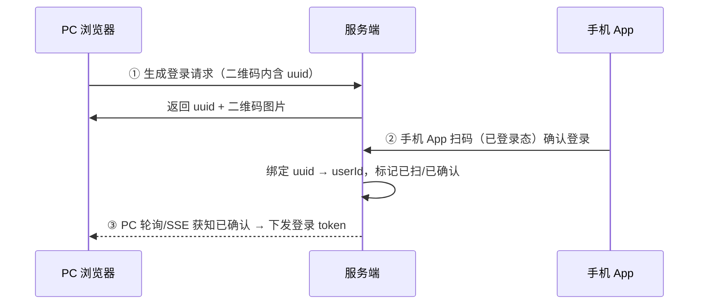

# 12 · 系统设计三题：短链接、扫码登录、限流器

系统设计面试的三道经典题——每题都能用你已学的知识组合出方案。

## 题一：短链接系统（3000 亿级）

**需求**：长 URL → 短码（如 `s.cn/Ab3xK9`）→ 访问 302 跳转；要求高并发读、不重复。

### 核心设计

```
① 生成短码：发号器自增 ID → Base62 编码（62⁷ ≈ 3.5 万亿，7 位够用）
   ❌ 哈希（MD5 截断）：会碰撞
   ✅ 发号器：全局唯一 → 天然无碰撞（雪花/号段——分布式 ID 篇的方案）

② 存储：MySQL（url 映射）+ Redis 缓存热数据
   key: 短码 → value: 长 URL；布隆过滤器防恶意短码穿透

③ 跳转：301（浏览器永久缓存，不再回源——适合永不变化链接）
        vs 302（每次回源，可统计访问次数——短链接统计用 302）
```

### 你已学的知识组合

| 环节 | 方案 | 出处 |
|------|------|------|
| 发号 | 雪花/号段（分布式 ID 篇） | j-core/11 |
| 高并发读 | Redis 缓存 + 缓存穿透防护（空值/布隆） | r-stage3/01 |
| 访问统计 | INCR 计数 + 异步刷库（Write Behind） | community |
| 安全 | 短码白名单校验（防恶意跳转钓鱼） | r-stage3/01 |

**追问预演**：①"同一个长 URL 重复生成？"→ 加长 URL 唯一索引返回已有短码；②"短链接被恶意刷量？"→ IP 限流+黑名单；③"跳转服务挂了？"→ 无状态多实例+Redis 降级本地缓存。

## 题二：扫码登录

**需求**：PC 端显示二维码，手机扫码后 PC 自动登录。

### 时序设计（Mermaid——面试画这张图）



### 状态机与轮询

```
二维码状态：WAITING(待扫) → SCANNED(已扫待确认) → CONFIRMED(已确认)
Redis 结构：
  qrcode:uuid:{uuid} → WAITING/SCANNED/CONFIRMED（TTL 5 分钟防过期码重放）
  qrcode:token:{uuid} → 登录 token（确认后写入）
PC 轮询 GET /api/qrcode/{uuid}/status（1~2s 一次）；确认后状态变 CONFIRMED + token
```

**追问预演**：①"轮询压力大？"→ SSE/长轮询替代；②"二维码过期？"→ 5 分钟 TTL + 前端刷新；③"手机扫码用什么登录态？"→ App 内置登录态 + 设备绑定校验。

**你已学的组合**：Redis TTL（二维码时效）、Set/UUID、轮询 vs SSE（网络篇 03 的 SSE 流式同款机制）、状态机推进。

## 题三：限流器设计（100 QPS 接口保护）

### 四种算法对比（必背）

| 算法 | 原理 | 缺陷 |
|------|------|------|
| 固定窗口 | 每分钟计数≤100 | **窗口边界突刺**（交界处 2 倍） |
| 滑动窗口 | 窗口切格子滑动统计 | 消除突刺，实现稍复杂 |
| 漏桶 | 恒定速率流出 | 平滑但无法应对突发 |
| **令牌桶** | 匀速放令牌，桶容量容忍突发 | 主流选择（Sentinel/Guava RateLimiter） |

### Redis 分布式限流（Lua 原子版——滑动窗口）

```lua
-- 滑动窗口限流：ZSET 存请求时间戳
redis.call('ZREMRANGEBYSCORE', KEYS[1], 0, ARGV[1] - 60000)   -- 清 60s 前的
local n = redis.call('ZCARD', KEYS[1])
if n >= tonumber(ARGV[2]) then return 0 end                    -- 超限拒绝
redis.call('ZADD', KEYS[1], ARGV[1], ARGV[1])                  -- 记录本次
return 1
```

（ARGV[1]=当前毫秒，ARGV[2]=最大 QPS——**单 Redis 原子执行**，分布式多实例天然共享限流状态）

### 你已学的组合

| 环节 | 方案 | 出处 |
|------|------|------|
| 分布式限流状态共享 | Redis ZSET/Lua | r-stage3/01 Lua 原子 |
| 单机限流 | Guava RateLimiter（令牌桶） | — |
| 网关限流 | Gateway RequestRateLimiter（微服务04） | — |
| 降级 | 超限返回 429 + 前端友好提示 | — |

**限流分层哲学**（秒杀漏斗同款）：网关层粗限 → 服务层细限 → 资源层池化保护，每层各司其职。

## 面试问法

**Q: 设计一个限流器？**
A: 单机用令牌桶（Guava RateLimiter）；分布式用 Redis Lua 原子滑动窗口（ZSET 记时间戳，ZCARD 判数，ZREMRANGEBYSCORE 清过期）——保证多实例共享状态且原子。分层：网关粗限+服务细限+资源池化兜底。拒绝策略：快速失败 429 或排队等待（按业务）。

---

**系统设计三题完成** ✅。续篇：[14-系统设计进阶三题](14-系统设计进阶三题.md)（点赞/抢红包/消息推送）——秒杀、Feed 流已有专篇，套路同上，**所有组件都在你的知识地图里**。
