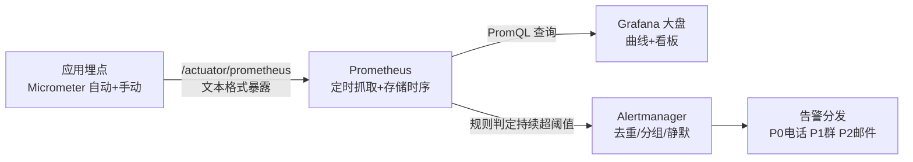

# 04 · 监控告警：让系统主动告诉你"要出事了"

排查能力（[JVM 04/05](../02-JVM虚拟机/04-JVM调优与常用工具.md)、[Linux 02](02-Linux排查命令速查.md)）是"出事之后找原因"；监控是**出事之前被通知**。mq-mall 已经暴露了 actuator 端点（`management.endpoints...include: health,info,metrics`）——本篇把"有了数据"补全成"有了眼睛和铃铛"。

## 三支柱分工（与 stage6/04 OTel 篇衔接）

| 支柱 | 回答什么问题 | 工具 | 本工作区 |
|------|------------|------|---------|
| **Logs** | 出事的细节上下文 | Logback → Loki/ELK | traceId 已注入 MDC（stage6/04） |
| **Traces** | 一次请求的跨服务旅程 | OTel/Micrometer Tracing + Zipkin | stage6/04 已落地 |
| **Metrics** | 系统整体水位、趋势、**该告警什么** | **Micrometer + Prometheus + Grafana** | 本篇 |

**关系**：告警靠 Metrics 发现 → 定位先看 Trace（哪一段慢）→ 细节翻 Log（当时打的确切日志）。**发现的入口是本篇。**

## 如何使用：从 Actuator 到 Prometheus 到大盘



**① 应用侧（mq-mall 现成+一步扩展）**：

```yaml
# pom 加 micrometer-registry-prometheus，yml 放行端点
management:
  endpoints.web.exposure.include: health,info,metrics,prometheus
  metrics.tags.application: mq-mall          # 多服务共用 Prometheus 时区分来源
```

自动白拿的指标：JVM（堆/GC/线程池——[JVM 04](../02-JVM虚拟机/04-JVM调优与常用工具.md) 的参数在曲线上一目了然）、HTTP（QPS/延迟/状态码）、RabbitMQ 连接、HikariCP 连接池活跃数。

**② 业务自定义指标（面试加分项——"你们监控什么？"答系统+业务两层）**：

```java
@Component
public class SeckillMetrics {
    private final Counter orderCounter;
    public SeckillMetrics(MeterRegistry registry) {
        orderCounter = registry.counter("seckill.order.total", "result", "success");
    }
    public void recordSuccess() { orderCounter.increment(); }
    // 秒杀下单成功数曲线 + 失败 counter（tag result=failure）
    // → 成功/失败比例突变 = 库存被刷/接口异常，比 CPU 曲线早 10 分钟发现问题
}
```

**③ Prometheus 抓取 + PromQL 三句入门**：

```promql
rate(http_server_requests_seconds_count[5m])              # 最近 5 分钟 QPS
histogram_quantile(0.99, rate(http_server_requests_seconds_bucket[5m]))  # P99 延迟
rabbitmq_queue_messages{queue="order.create"}             # 队列堆积深度（mq stage3/04 的"治堆积"要先"看见堆积"）
```

**④ 告警规则**（Prometheus rule：**持续 5 分钟**超过阈值才发——单点毛刺不告警）：

```yaml
- alert: QueueBacklog
  expr: rabbitmq_queue_messages{queue="order.create"} > 10000
  for: 5m
  labels: { severity: P1 }
  annotations:
    summary: "订单队列堆积 {{ $value }} 条，消费者可能挂了"
```

## 四个黄金指标（Google SRE，背下来）

| 指标 | 含义 | 典型告警 |
|------|------|---------|
| **延迟** | 服务响应时长（看 **P99** 不是平均值） | P99 > 1s 持续 5 分钟 |
| **流量** | QPS/消息量 | 流量骤降 50%（可能上游或入口挂了） |
| **错误** | 5xx 比例 / 业务失败率 | 错误率 > 1% |
| **饱和度** | 资源水位（连接池/队列/磁盘） | HikariCP 活跃=最大、磁盘 > 80% |

**平均值会骗人**：1000 个请求 999 个 50ms、1 个 30s——平均 80ms 看着健康，P99=30s 暴露尾部灾难。**看分位数是监控和日志最大的思维差异。**

## 告警纪律（比工具重要）

- **每条告警必须可执行**：收到后知道"该干什么"（去看哪个大盘/跑哪个脚本）。❌ "CPU 高"（然后呢？）✅ "mq-mall-2 堆使用率 92%，附 jmap 命令模板"
- **分级**：P0 电话叫醒（资损/不可用）→ P1 群里 @值班 → P2 邮件白天看
- **防告警风暴**：故障常常连锁触发 50 条告警——Alertmanager 按 label **分组**（同一服务合并成一条）+ **静默窗口**（正在处理中不再重复响）
- **消灭"狼来了"**：误报 3 次没人再信告警——阈值别拍脑袋，上线后按实际水位调
- **业务指标是最后一道防线**：技术指标全绿但"支付成功率"掉到 80%——只有业务大盘能发现（03 篇表格里"最重要也最常被忽略"的那行）

## 与已有教学的联动（监控视角复习）

| 已学内容 | 监控形态 |
|---------|---------|
| JVM 调优（02-JVM/04） | 堆/GC/线程池指标上 Grafana 曲线，调优效果肉眼可见 |
| MQ 堆积治理（mq stage3/04） | `rabbitmq_queue_messages` 告警 = 堆积的自动发现 |
| Redis 命中率/大 Key（r-stage3） | exporter 指标：命中率骤降=缓存失效风暴前兆 |
| 本地消息表/对账（mq stage4） | 对账不一致数本身就是一条业务告警 |
| OTel Tracing（stage6/04） | 告警 → Trace → Log 的定位三连 |

## 面试问法

**Q: 你们系统的监控告警是怎么做的？**
A: 三支柱：Metrics（Micrometer→Prometheus→Grafana）做告警入口，Tracing（OTel，traceId 贯穿日志）定位慢在哪一段，日志看细节。监控四黄金指标：延迟（看 P99 不看均值）/流量/错误率/饱和度，外加**业务指标**（订单量/支付成功率）。告警纪律：持续超阈值才触发、每条可执行、P0~P2 分级、分组静默防风暴。发现→定位链路：告警拉群 → Grafana 确认水位 → TraceId 找到慢的 Span → 日志看现场。

---

**下一篇**：回 [13 模块 README](README.md) · 定位手段复习：[02-Linux排查命令](02-Linux排查命令速查.md) 与 [JVM 排查](../02-JVM虚拟机/05-常见OOM与线上排查.md)。
