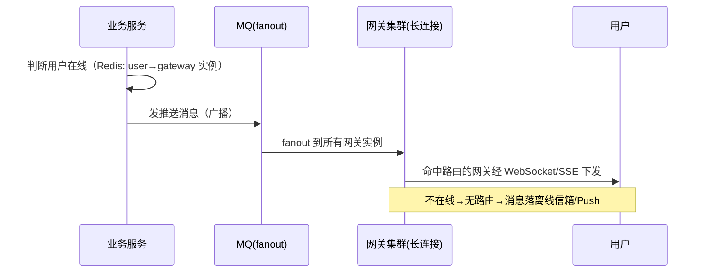

# 14 · 系统设计进阶三题：点赞、抢红包、消息推送

续 [12-系统设计三题](12-系统设计三题.md)（短链接/扫码登录/限流器），再练三道高频题。套路不变：**需求 → 核心设计 → 组合你已学的知识 → 追问预演**。

## 题一：点赞系统（千万级点赞/天）

**需求**：点赞/取消、点赞数展示、"我是否点过"、点赞列表；**写多读多**，热门内容瞬间万级并发点赞。

### 核心设计

```
① 状态与计数全走 Redis，MySQL 只做最终归档
   点过没点过：Set  SADD like:set:{msgId} uid    返回 0=已点过（天然防重）
   点赞数：    String  INCR / DECR like:cnt:{msgId}（原子）
   我赞过的：  Set  like:user:{uid}（"我的点赞"列表页用）

② ❌ 每次点赞直接 UPDATE msg SET count=count+1：热点行锁排队，DB 直接被打爆
   ✅ Redis 原子先响应 → MQ 异步批量刷 MySQL（攒 100 条或 500ms 刷一次）

③ 一致性兜底：Redis 只是加速层不是真相源
   定时对账任务：SUM(MySQL 明细) vs Redis 计数，不一致以明细为准修正（mq-mall reconcile 同款思想）
```

### 防重 + 计数原子化（Lua——三条命令不再分步）

```lua
-- KEYS[1]=点赞Set  KEYS[2]=计数key  ARGV[1]=uid
if redis.call('SADD', KEYS[1], ARGV[1]) == 0 then
  return -1                                   -- 已点过，幂等拒绝
end
redis.call('INCR', KEYS[2])
return 1
```

### 你已学的组合

| 环节 | 方案 | 出处 |
|------|------|------|
| 防重复点赞 | Set SADD 返回值判断 / Lua 原子 | r-stage5/04、r-stage4/01 |
| 计数 | INCR 原子 + 异步刷库 | community Write Behind |
| 削峰 | MQ 异步落库 | mq stage3 |
| 一致性 | 定时对账 + 修正 | mq-mall reconcile |
| 防刷 | 同一 uid 高频点赞 → 限流 | r-stage5/01 |

**追问预演**：①"Redis 宕机点赞丢了？"→ AOF + 主从；丢的靠对账任务从 MySQL 明细重建；②"点赞列表要分页？"→ Set 不能分页，热门内容改 ZSET（score=点赞时间戳）`ZREVRANGEBYSCORE` 翻页，或落一张 MySQL 明细表分页；③"大 V 内容百万点赞单 key 热点？"→ 计数 key 分片 `like:cnt:{id}:0..9` 相加求和（大 Key 篇方案）。

## 题二：抢红包（微信红包）

**需求**：发红包（金额拆分）、抢（**不超发、不重复、不少发**）、拆账明细、24h 未领完退回。

### 核心设计

```
① 拆分前置：发红包时用「二倍均值法」一次性拆好 N 份
   每份 = random(0.01, 剩余金额/剩余人数×2)，最后一人拿剩余——保证总和正确、人人≥0.01
   ❌ 抢的时候实时随机拆：并发下"剩余金额"是共享变量，要加锁，慢
   ✅ 预拆好放 Redis List：抢 = LPOP——单命令原子，天然不超发不重复

② 抢（LPOP 原子认领）
   LPOP red:pkg:{id} → 拿到金额 → MQ 异步写明细表 → 返回
   LPOP 返回 nil = 抢完；同一用户抢第二次：Set SADD red:owner:{id} uid 返回 0 = 已抢过

③ 超时退回：发红包时投一条 24h 延迟消息 → 未领完的余额原路退款（死信/延迟插件同订单超时关单）
```

### 为什么快：把计算挪到写少的一侧

| 阶段 | 并发量 | 干什么 |
|------|--------|--------|
| 发红包（写少） | 1 次 | 拆分 N 份 + LPUSH N 次——重活放在这里 |
| 抢红包（读多） | 万人并发 | **LPOP 一次弹出**，O(1) 无锁 |

### 你已学的组合

| 环节 | 方案 | 出处 |
|------|------|------|
| 不超发 | 预拆分 = 预扣库存同款思想 | r-stage4/01 |
| 原子认领 | List LPOP 单命令原子 | r-stage1/03 |
| 防重复抢 | Set SADD 返回值 | r-stage5/04 |
| 明细削峰 | MQ 异步落库 | mq stage4 秒杀链路 |
| 超时退回 | 延迟队列（死信/插件/ZSet 时间轮三选一） | mq stage4 订单超时、r-stage4/03、learn-center 延迟链 |

**追问预演**：①"明细落库前 Redis 挂了？"→ 明细以 MQ 消息为准重投 + 对账；红包主体金额发时可先落 MySQL（状态=进行中），认领完落明细改状态；②"万人抢一个红包，单 List 热点？"→ key 分片 `red:pkg:{id}:0..9`，客户端轮询 LPOP（热 Key 篇方案）；③"抢到但没点'存入零钱'？"→ 抢=认领锁定，确认=入账，两阶段+超时回收。

## 题三：消息推送系统（站内信/公告/私信，亿级用户）

**需求**：系统公告全员可达、点对点私信、已读未读数、在线实时送达。

### 核心设计

```
① 通道选择：在线走长连接（WebSocket/SSE）实时推；离线转厂商 Push；再兜底"拉取"
② 全员公告：❌ 给 1 亿用户各插一条站内信（写爆库）
            ✅ 读扩散：公告全局只存一条，用户带「已读位点」
               未读数 = 最新公告 ID − 我的已读位点 → O(1)，亿级用户也只是一条公告
③ 私信/群聊：写扩散（推）——每人收件箱一条（Redis List/MySQL 分表）
   大 V 群发：读扩散（拉）——Feed 流推拉结合同款：穷人推、大 V 拉、粉丝混用
④ 已读未读：会话维度记 last_read_msg_id 位点，未读数 = 会话最新 msg_id − 位点
```

### 在线推送的路由（Mermaid——面试画这张）



### 你已学的组合

| 环节 | 方案 | 出处 |
|------|------|------|
| 实时下发 | SSE 流式（WebSocket 升级版同理） | stage7/02、learn-center SSE 答疑 |
| 推拉结合 | 写扩散+读扩散混合 | r-stage5/03 Feed 流 |
| 广播 | MQ fanout | mq stage1 |
| 在线路由表 | Redis hash：uid→网关实例 | — |
| 亿级未读 | 位点差值 O(1) | — |

**追问预演**：①"网关实例挂了，在线用户怎么办？"→ 心跳断开删路由 → 自动转离线通道，重连后拉取补齐（消息 ID 去重保证不丢不重）；②"推送顺序性？"→ 单会话内按 msg_id 单调，客户端按 ID 排序去重（消费端幂等思想）；③"千万设备同时推一条公告？"→ 分批 + 优先级队列 + 厂商通道限流，在线的走长连接零成本（公告是读扩散，不需要"推"给每个人）。

## 面试问法

**Q: 设计一个点赞系统？**
A: Redis Set 防重（SADD 返回 0 即已赞）+ String INCR 计数，Lua 保证判重与计数原子；MySQL 只异步批量归档（MQ 削峰），定时对账以明细为准修正缓存；热点 key 分片防大 Key。

**Q: 设计一个微信红包？**
A: 发红包时二倍均值法预拆分（写少侧干重活），抢=LPOP 原子认领天然不超发，Set 防同人重复抢，MQ 异步落明细，延迟队列做 24h 未领退款——本质是"预扣库存 + 异步化"的变体。

**Q: 设计一个消息推送系统？**
A: 通道三层：在线长连接（SSE/WebSocket）→ 离线厂商 Push → 拉取兜底。扩散模型按量选择：私信写扩散、公告/大 V 读扩散（Feed 流推拉结合同款），未读数用"最新 ID − 已读位点"差值 O(1)；集群下发靠 MQ fanout + Redis 路由表。

---

**三题完成** ✅。续篇：[15-系统设计·支付系统](15-系统设计·支付系统.md)——综合度最高的收官题（状态机 CAS/回调幂等/对账），也是 mq-mall 订单链路的期末考试。回 [12-系统设计三题](12-系统设计三题.md) 复习第一组。
