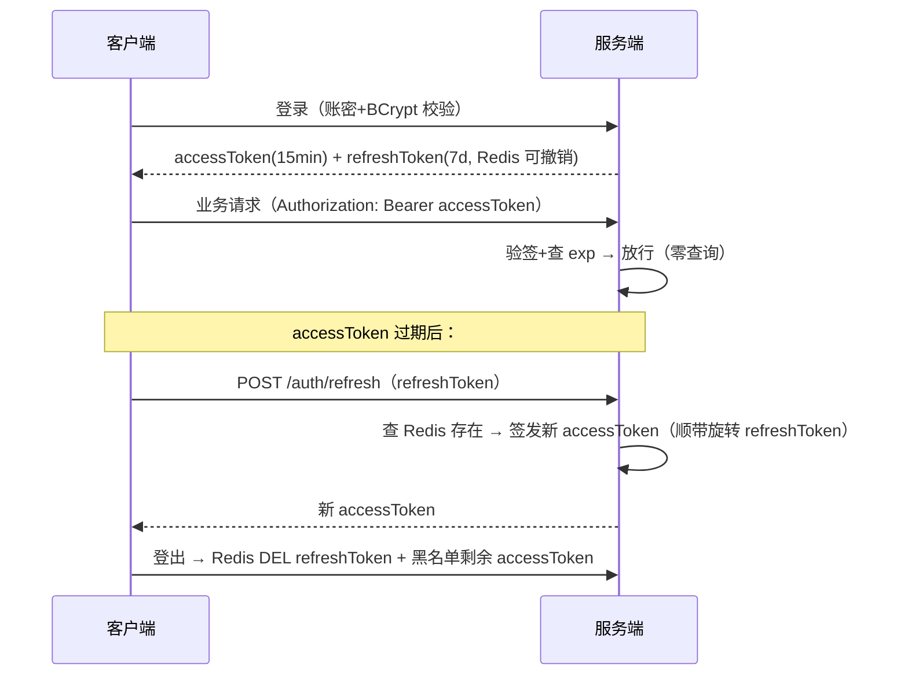

# 19 · 登录态与接口安全：从"每接口传 token"到统一鉴权

> 🎯 **定位**：你的两个项目都已经有登录功能——learn-center 用"UUID token + Redis + 拦截器 + ThreadLocal UserContext"，community 还停留在"每接口传 `?token=`"。但**为什么这么做、生产怎么升级、面试官追问"JWT 了解吗""越权怎么防"**时，这些散落的知识没被串成线。本篇是收拢篇（同 [18-操作系统基础](18-操作系统基础.md) 的定位）：认证 vs 授权、三种登录态方案对比、JWT 原理与 logout 难题、密码存储、越权/重放防护——每个概念都"对号入座"到你已写的代码。

## 一、先分清：认证（Authentication）与授权（Authorization）

```
认证 AuthN：你是谁？        → 登录（token/session 证明身份）
授权 AuthZ：你能干什么？     → 权限校验（这个接口/数据允许你动吗）
   │
   ├─ 功能权限：能不能调这个接口（管理员才能删帖）
   └─ 数据权限：这条数据是不是你的（越权防护，见第五节）
```

**面试常考的区分**：401（未认证——没带 token/token 过期，该跳登录）vs 403（已认证但无权限——该提示"没有权限"）。追问链 12 的错误码分层直接用到（[16 篇](16-接口设计规范.md) 错误码分段）。

## 二、三种登录态方案：Session → Redis Token → JWT

### 方案对比（必背骨架）

| 维度 | ① Session（Tomcat 内存） | ② Redis Token（你两个项目的方案） | ③ JWT（无状态签名） |
|------|------------------------|-------------------------------|-------------------|
| 存哪 | 服务端内存（JSessionId 关联） | 服务端 Redis（token→userId） | **客户端**（签名串自带身份） |
| 服务端查询 | 本地内存 O(1) | 每次 Redis GET（1 次 RTT） | **零查询**（验签即信） |
| 多实例 | ❌ 要粘性会话/复制 | ✅ Redis 天然共享 | ✅ 天然无状态 |
| 踢人/登出 | ✅ 销毁 session 即刻生效 | ✅ DEL 即刻生效 | ❌ **签出去收不回**（见下） |
| 移动端友好 | Cookie 受限 | ✅ Header 自由传 | ✅ Header 自由传 |
| 数据大小 | session 任意大 | Redis 里任意大 | Header 里放 userId/角色，**别塞敏感信息** |

**你项目的位置**：learn-center/community 的 `UUID.randomUUID() + Redis 7 天 TTL` = 方案②——单实例时看起来"多此一举"，但**多实例部署时登录态天然跨实例共享**（community README 简化点表里写的"多实例时登录态/锁/计数天然跨实例——Redis 的价值所在"）。这是"每一步简化都是为教学聚焦，生产升级路线清晰"的又一个例子。

### 拦截器统一鉴权：learn-center 的做法（正确姿势）

community 每个接口手工调 `auth(token)`——校验代码和业务代码耦合，漏一个接口就是漏洞。learn-center 把校验**上移到 HandlerInterceptor**：

```java
// AuthInterceptor（learn-center/src/main/java/com/example/learn/config/）
public boolean preHandle(req, resp, handler) {
    String token = req.getHeader("Authorization");          // ① 从头取（❌ URL 传参会被日志/Referer 泄漏）
    if (token == null) { resp.setStatus(401); return false; } // ② 白名单之外的接口统一 401
    String userId = redis.get("lc:token:" + token);
    if (userId == null) { resp.setStatus(401); ...; return false; } // ③ 过期/伪造 → 401 跳登录
    UserContext.set(Long.parseLong(userId));                 // ④ ThreadLocal 传递，业务零感知
    return true;
}
```

**⚠ 全篇最重要的一个坑**（[ThreadLocal 篇](01-并发编程/07-并发容器与ThreadLocal.md) 泄漏问题的同族）：

```java
public void afterCompletion(...) { UserContext.clear(); }
```

Tomcat 线程池**线程复用**——不清理，下一个请求拿到上一个用户的 userId，**串号**。这就是并发篇"线程池线程不死则 value 泄漏"在业务层的真实形态。拦截器的三件套：preHandle 校验、ThreadLocal 传递、afterCompletion 清理。

**进阶控制**：接口级白名单/注解标记（`@RequireLogin`）→ Spring Security 的声明式授权思想雏形（见第六节）。

## 三、JWT：结构、验签、以及"登出难题"

### 结构与原理

```
Header.Payload.Signature    （三段 Base64URL，用 . 连接）

Header  ：{"alg":"HS256","typ":"JWT"}          ← 声明签名算法
Payload ：{"sub":"1001","role":"user","exp":1730000000}  ← 身份+过期时间（明文！只是编码不是加密）
Signature：HMAC-SHA256(base64(header).base64(payload), 密钥)
```

验签过程：服务端用**同一密钥**对前两段重算签名，比对第三段——**一致=没被篡改**（改了 Payload 重算不出正确签名）。所以服务端**不需要存任何东西**，这就是"无状态"。

**必考陷阱**：
1. **Payload 是明文**——Base64 是编码不是加密，手机号/密码放进去等于裸奔（[日志脱敏](17-日志规范.md) 同一纪律）；
2. **token 一旦签发，到期前无法撤销**——"改密后旧 token 还能用""登出只是前端删 localStorage"都是这个根；
3. 密钥泄露 = 全线失守，生产用 RS256 非对称（私钥签发、公钥验签）。

### JWT 的"登出难题"三解法（面试高频）

| 解法 | 做法 | 代价 |
|------|------|------|
| 短过期 + 刷新令牌 | access token 15 分钟 + refresh token 7 天（Redis 可撤销） | refresh token 又回到"有状态"——纯无状态只存在于 15 分钟窗口 |
| 黑名单 | Redis 存已注销 token（`jwt:blacklist:{jti}`，TTL=剩余有效期） | 每请求多一次 Redis 查——**退化成方案②+签名** |
| 版本号 | 用户表存 tokenVersion，改密 +1；Payload 带版本，不一致即拒 | 每次验签要查库（可缓存） |

**结论（能一句话讲清就赢）**：JWT 的"无状态"和"可撤销"是一对根本矛盾——**要么接受撤销延迟（短过期），要么把状态加回来（黑名单/版本号）**。所以"Redis token vs JWT"不是先进落后，是**一致性模型的选择**：要强踢人选②，要跨服务零查询选③+短过期。

### 双 token 完整时序（面试画这张）



## 四、密码存储：MD5 为什么不行，BCrypt 为什么行

你两个项目都用 MD5——教学简化可以，但**生产是事故级**：

| 方案 | 问题 |
|------|------|
| 明文 | 拖库即泄漏（不可原谅） |
| MD5/SHA256 | 速度太快——GPU 每秒算几十亿次，彩虹表反查秒破 |
| MD5+盐（固定盐） | 盐硬编码=全体用户共享，拖库一次破解全部 |
| **BCrypt/Argon2（ salt 每用户随机 + 慢哈希）** | 每次校验故意耗时 ~100ms，撞库成本爆炸；盐嵌在哈希串里免管理 |

```java
// 注册：一行搞定（盐自动生成嵌入）
String hash = BCrypt.hashpw(rawPassword, BCrypt.gensalt(12));  // 12 = cost factor
// 登录：
boolean ok = BCrypt.checkpw(rawPassword, storedHash);          // 从 hash 里解出盐再慢哈希比对
```

**原理一句话**：慢哈希把"GPU 一秒 40 亿次"变成"一秒 4 次"（cost=12 时约 250ms/次）——把攻防从"拼运气"变成"拼算力成本"。配套纪律：传输走 HTTPS（[网络篇 02](07-网络基础/02-HTTP协议演进与HTTPS.md)）、前端不做"密码 MD5 后再传"（假安全感，MD5 结果就是新密码）。

## 五、数据越权：后端面试最常被追问的安全题

**水平越权**：A 用户拿到 B 用户的数据——改 URL 里的 ID（`GET /api/orders/123` 里的 123 是别人的订单号）。
**垂直越权**：普通用户调到管理员接口。

**防御只有一条铁律：信任的只有登录态里的 userId，URL/Body 里传的任何 ID 都必须查归属**：

```java
// ❌ 直接用参数查——IDOR（不安全的直接对象引用）
orderMapper.selectById(request.get("orderId"));

// ✅ 查出来后校验归属（或查询条件直接带 userId）
Order order = orderMapper.selectById(orderId);
if (!order.getUserId().equals(UserContext.get())) throw new BizException("无权操作", 403);
// 更优：SQL 层直接 where user_id = ? —— 一次查询，天然不越权
```

**对号入座**：mq-mall 支付链路"回调里核对订单金额与商户单号归属"（[15 篇](15-系统设计·支付系统.md) 金额安全关卡）就是这个思想的资金级版本。**垂直越权**：拦截器校验登录后，再按角色/权限点校验——小项目手写 `if (!"admin".equals(user.getRole())) 403`，大项目 RBAC（角色-权限点表）或 Spring Security `@PreAuthorize("hasRole('ADMIN')")`。

## 六、防重放与接口签名（开放接口才需要）

内部接口 HTTPS 已够；**对外开放/支付回调类接口**要防"抓包重放"：

```
签名五件套：appId + timestamp + nonce + params + sign
  ① timestamp：±5 分钟窗口，超窗直接拒（缩小重放有效时长）
  ② nonce：Redis SETNX 存 5 分钟——同一随机数只许用一次（截获了也用不了）
  ③ sign：对参数按 key 排序拼接后 HMAC-SHA256（密钥只在两端）
  ④ 服务端按同样规则重算比对
```

**成本意识（面试加分点）**：三件套 = 每请求多一次 Redis 写（nonce）+ 一次验签计算。内部服务间调用（[OpenFeign](05-微服务全家桶/03-OpenFeign.md)）在内网 + 服务间认证即可，**不要无脑给所有接口上签名**——和 [16 篇](16-接口设计规范.md)"错误码别过度分段"同一工程判断。

## 七、方案落地路线（你项目的升级地图）

| 现状（learn-center/community） | 生产升级 | 对应本篇 |
|------|------|------|
| UUID token + Redis 7 天 | 保留即可；跨服务网关统一校验（[微服务 04](05-微服务全家桶/04-Gateway网关.md) 全局过滤器） | 第二节 |
| URL 传 token（community） | 统一 Authorization 头 + 拦截器 | 第二节 |
| MD5 密码 | BCrypt cost≥10 | 第四节 |
| 只有认证没有归属校验 | 数据层 where user_id=? | 第五节 |
| 单实例 | 多实例：Redis 登录态已就绪，Session 方案反而要改造 | 第二节对比表 |

## 面试问法

**Q1: Session、Redis Token、JWT 怎么选？**
A: 三个维度看——①存储位置：Session 内存、Redis Token 服务端、JWT 客户端自带；②扩展性：Session 多实例要粘性会话，Redis Token 靠 Redis 共享，JWT 天然无状态；③可撤销性：前两者 DEL 即刻生效，JWT 签发后到期前收不回，要黑名单/短过期+刷新令牌/版本号，本质是把状态加回来。我的项目用 Redis Token——多实例天然共享、能强踢人，如果做成微服务再上 JWT+15 分钟短过期，网关统一验签省下游查询。

**Q2: JWT 为什么无法真正登出？怎么解决？**
A: 因为服务端不存 token 状态——验签只证明"没被篡改"，无法证明"已被注销"。解法三选一：短过期+刷新令牌（把撤销窗口压到 15 分钟）、黑名单（Redis 存到过期为止，退化成有状态）、用户级版本号（改密+1）。核心认知：无状态和可撤销是 JWT 的根本矛盾，选型就是选矛盾侧重。

**Q3: 密码怎么存？MD5 加盐行不行？**
A: 不行——MD5 速度太快（GPU 每秒数十亿次），彩虹表/撞库成本低。用 BCrypt/Argon2：每用户随机盐（自动嵌在哈希串里）+ 可调 cost 的慢哈希（cost 12 约 250ms），把撞库从"拼运气"变"拼算力"。传输层 HTTPS 保证，前端预哈希无意义。

**Q4: 接口越权怎么防？**
A: 分水平/垂直。水平越权（改 ID 查别人数据）：信任的只有登录态 userId，数据归属要么查出后比对、要么 SQL 直接 `where user_id=?`；垂直越权（调管理员接口）：拦截器登录校验之上加角色校验，RBAC 或注解声明式。我在项目里所有查询都带 UserContext 里的 userId 做条件——参数 ID 只用于定位，不用于信任。

**Q5: 怎么防接口重放？**
A: timestamp ±5 分钟窗口缩小重放时长，nonce + Redis SETNX 保证单次有效，参数排序后 HMAC 签名防篡改。但有成本（每请求多一次 Redis 写），内部服务不套用——工程上安全强度和调用成本要平衡，开放接口和支付回调才上全套。

---

**下一篇**：回 [java-core README](README.md) · 配套：[18-操作系统基础](18-操作系统基础.md)（ThreadLocal/HTTPS 的底层）、[15-系统设计·支付系统](15-系统设计·支付系统.md)（回调验签与资金安全）、[16-接口设计规范](16-接口设计规范.md)（401/403 错误码分层）。
