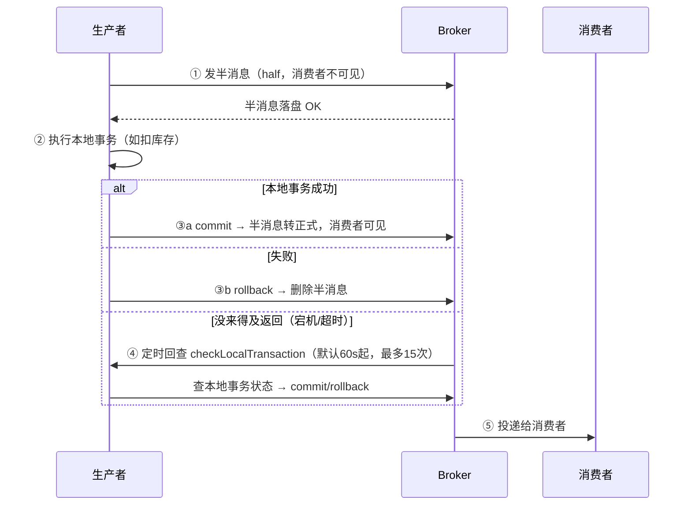

# 01 · RocketMQ 架构与事务消息

RabbitMQ 教你模型，Kafka 篇教吞吐——这篇补上国内业务系统最常见的第三块拼图：**你工作区的 pmhub（SpringCloud Alibaba 体系）用的就是 RocketMQ**，面试里"事务消息、延迟消息"基本默认问它。

## 一、架构总览：NameServer 有多"轻"

```
Producer ──拉路由(每30s)──→ NameServer1/2/3（无状态，互不通信）
   │                            ↑ 心跳(每30s)+注册
   │发送消息              ┌─────┴──────┐
   └────────────────→  Broker 主  ←─同步/异步── Broker 从
                            │ 读写
                       Consumer ──拉取（长轮询，每队列）
```

| 角色 | 职责 | 对照你学过的 |
|------|------|-------------|
| **NameServer** | 路由注册中心，**无状态**、节点间不通信（最终一致） | Nacos 注册中心的极简版（java-core/05/01）——没有心跳保护阈值那套 |
| **Broker 主** | 消息存储、读写、消费进度管理 | RabbitMQ 的 Broker + 队列 |
| **Broker 从** | 同步主的数据，主挂可读不可写（4.5+ 支持 Dledger 自动主从切换） | Redis 主从（r-stage2/05） |
| **Consumer** | 推/拉消费，**长轮询**（拉不到挂起 15s，来消息立即返回——Nacos 配置中心同款机制，j-core/05/02） | |

**存储特色（对比 Kafka 的分区日志）**：所有 Topic 的消息**混写同一个 CommitLog**（顺序写，磁盘友好），再异步分发到各 Topic 的 **ConsumeQueue**（逻辑队列索引）。Kafka 是每分区一个日志文件——Topic 多了碎片化严重；RocketMQ 用"单文件顺序写 + 索引分发"换**多 Topic 场景的高性能**（业务系统 Topic 多，日志系统 Topic 少——这就是两者定位差异的根源）。

## 二、事务消息：半消息 + 回查（本篇核心）

**问题**：本地事务和发消息不能同事务——DB 提交了，发消息失败 → 下游丢消息；先发消息，DB 回滚 → 下游多消费。（本地消息表的痛点，mq stage3/01）

**RocketMQ 的解法：两阶段 + 服务端回查**



```java
// Spring BootRocketMQ（pmhub 写法同款）
@RocketMQTransactionListener
class TxListener implements RocketMQLocalTransactionListener {
    public RocketMQLocalTransactionState executeLocalTransaction(Message msg, Object arg) {
        orderService.deductStock(...);              // 本地事务
        return RocketMQLocalTransactionState.COMMIT;
    }
    public RocketMQLocalTransactionState checkLocalTransaction(Message msg) {
        // 回查：别猜，去查库/查事务日志的真实状态
        return orderLogService.exists(txId) ? COMMIT : ROLLBACK;
    }
}
```

**本质**：把"本地消息表"内置进了 Broker——**半消息=待确认的消息表，回查=补偿任务扫表**（mq-mall 的 reconcile 同款思想搬到了服务端）。你手写本地消息表 vs 用事务消息：

| | 本地消息表（mq stage3/01） | RocketMQ 事务消息 |
|--|--------------------------|-------------------|
| 依赖 | 业务库一张表 + 扫描任务 | Broker 内置 |
| 一致性窗口 | 扫描周期（秒级延迟） | 回查周期（默认更快） |
| 换 MQ 就失效 | ❌ 与 MQ 无关 | ✅ 绑定 RocketMQ |

**半消息对消费者不可见**是关键设计——不 commit 永远不会被消费，天然防"提前消费"。

## 三、延迟消息：18 个等级开箱即用

```
等级：1s 5s 10s 30s 1m 2m 3m 4m 5m 6m 7m 8m 9m 10m 20m 30m 1h 2h
发送时只设 level：msg.setDelayTimeLevel(16)  // 30m——订单超时取消
```

- 实现：Broker 内置 `SCHEDULE_TOPIC_XXXX` 内部主题按等级分队列，定时任务扫到时间再投递（**延迟消息在服务端排队**，不是生产者等待）
- 5.x 起新增**任意精度定时**（TimerWheel 时间轮——并发篇时间轮思想的落地）
- ❌ RabbitMQ 要 TTL+死信 或延迟插件（mq stage3/05 的绕法）；❌ Kafka 无原生延迟

**分工同 XXL-Job 篇**：精确一次性延迟（这单 10:30 关）→ 延迟消息；周期性扫表（每 20s 扫一遍）→ 调度任务。订单超时取消（mq stage4/02）用延迟消息是更优解——不用扫全表。

## 四、消费可靠性与重试（对照 RabbitMQ 的 ACK/DLX）

```
消费失败 → 默认重试 16 次（间隔递增 10s~2h，进 %RETRY%消费组名 队列）
16 次仍失败 → 进 %DLQ%消费组名 死信队列 → 人工/补偿任务处理
```

对照：RabbitMQ 是 nack + DLX 死信交换机（stage3/05）；语义一致——**失败隔离 + 死信兜底**，RocketMQ 把"重试队列"做成了一等公民（重试不阻塞正常消费）。

## 五、选型收束（衔接三大 MQ 对比与 Kafka 选型篇）

| 场景 | 选 | 理由 |
|------|-----|------|
| 业务系统、要事务消息/延迟消息 | **RocketMQ** | pmhub 同款，Java 生态原生 |
| 教学/轻量路由（交换机模型直观） | RabbitMQ | 本教程主线 |
| 日志管道、大数据流、超高吞吐 | Kafka | 分区日志 + 生态（stage5-Kafka） |

## 面试问法

**Q: RocketMQ 事务消息原理？**
A: 两阶段：①先发**半消息**（落盘但消费者不可见）；②执行本地事务，成功 commit / 失败 rollback；③若生产者没返回（宕机），Broker **定时回查** `checkLocalTransaction`，生产者查库给出真实状态。本质是服务端内置的本地消息表：半消息=待确认表，回查=补偿扫描。半消息不可见保证不会提前消费。

**Q: RocketMQ 和 Kafka 存储的差异？**
A: Kafka 每分区独立日志文件，单分区顺序写性能极致，但 Topic/分区多时文件句柄与碎片暴增；RocketMQ 所有 Topic **混写单个 CommitLog**（顺序写）+ 异步分发 ConsumeQueue 索引，适合**业务消息多 Topic** 场景。所以日志/大数据选 Kafka，业务系统选 RocketMQ。

---

**下一篇**：[02-消费模式与重试](02-RocketMQ消费模式与重试.md)（集群/广播、16 级重试、顺序消息、位点回溯）· 回 [mq/README](../README.md) 总目录 · 对照复习 [三大 MQ 底层对比](../stage2-底层原理/04-三大MQ底层对比.md) 与 [Kafka 选型](../stage5-Kafka专篇/04-Kafka与RabbitMQ选型对比.md)。
