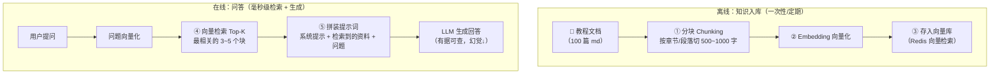

# 03 · RAG 与向量检索：让 AI"开卷考试"

LLM 的知识截止在训练时间点，且不知道你的私有数据。**RAG（Retrieval-Augmented Generation，检索增强生成）**= 提问前先检索相关资料塞进提示词——让 AI"开卷考试"。

## 为什么需要 RAG（三个真实痛点）

| 痛点 | RAG 解法 |
|------|---------|
| LLM 不知道你的私有知识（公司文档/教程内容/商品信息） | 把相关资料检索出来塞进提示词 |
| 训练一个领域模型成本天文数字 | 检索是毫秒级的（对比训练是天价） |
| 知识更新（文档改了 AI 不知道） | 检索实时反映最新文档——**更新知识=更新文档，不用重训** |

一句话：**RAG = "开卷考试"——AI 回答前先从你的知识库里查相关段落，照着资料回答**。幻觉大幅减少（有据可查）+ 知识可实时更新。

## RAG 全流程（离线 + 在线两阶段）



### 分块（Chunking）：RAG 效果的第一决定因素

切太碎 → 语义不完整；切太大 → 检索不精准+上下文浪费。**经验值**：500~1000 字/块，相邻块重叠 10~20%（保上下文连续）。Markdown 按标题层级切最自然（正好适合本工作区的 90 篇教程）。

## Redis 向量检索（呼应 r-stage6/03）

Redis Stack 的 RediSearch 模块（或 Redis 8 内置）提供向量索引。Spring AI 有现成的 `RedisVectorStore` 实现：

```java
// 离线入库：教程分块 → 向量化 → 存入
vectorStore.add(List.of(
    new Document("B+树非叶子节点只存键……", Map.of("course", "mysql", "chunk", "01"))
));

// 在线检索：问题向量化 → KNN 最相似的前 K 块
List<Document> similar = vectorStore.similaritySearch(
    SearchRequest.builder().query("索引为什么用 B+ 树").topK(3).build());
```

需要 `redis-stack` 镜像（带 RediSearch 模块）替换普通 redis——**模块能力差异**：普通 Redis 无向量检索（r-stage6/03 语义缓存篇提过）。

## 提示词模板（RAG 的灵魂）

```
你是 Java 后端学习助手。只根据下面的【参考资料】回答问题；
资料中没有的内容，明确回答"资料中未涉及"，不要编造。

【参考资料】
{retrieved_chunks}

【用户问题】
{question}
```

**三句关键设计**：①限定资料来源（抑制幻觉）②允许"不知道"（比编造强）③指明引用格式（前端可标注来源）。

## 与已有教学的联动（本工作区就是现成 RAG 素材库）

| 素材 | 来源 | 向量化后用途 |
|------|------|-------------|
| 90 篇教程 md | mq/redis/java-core/stage6 | "MQ 消息堆积怎么办"→检索堆积篇 |
| 踩坑实录 12 坑 | "发号器重启归零"→检索坑二 | **踩坑经验问答**（独有的差异化语料！） |
| 面试速查手册 40+ 题 | 面试题检索与追问 | 面试模拟 |

**用自己写的教程喂 RAG = 学最有感的最私有的知识库**——这就是 stage7/04 learn-center AI 答疑的设计。

## 面试问法

**Q: 什么是 RAG？为什么企业 AI 应用都用它？**
A: 检索增强生成——回答前先从知识库检索相关片段塞进提示词，让模型"开卷考试"。解决三痛点：私有知识（模型不知道你的数据）、时效性（更新文档即更新知识，不用重训）、幻觉（有据可查）。流程：离线分块→Embedding→向量库；在线问题向量化→Top-K 检索→拼装提示词→生成。分块粒度是效果第一决定因素；向量库选 Redis（小规模复用基础设施）到 Milvus（亿级）。

---

**下一篇**：[04-AI工程化-成本降级与评测](04-AI工程化与learn-center落地.md)——learn-center 三功能落地。
