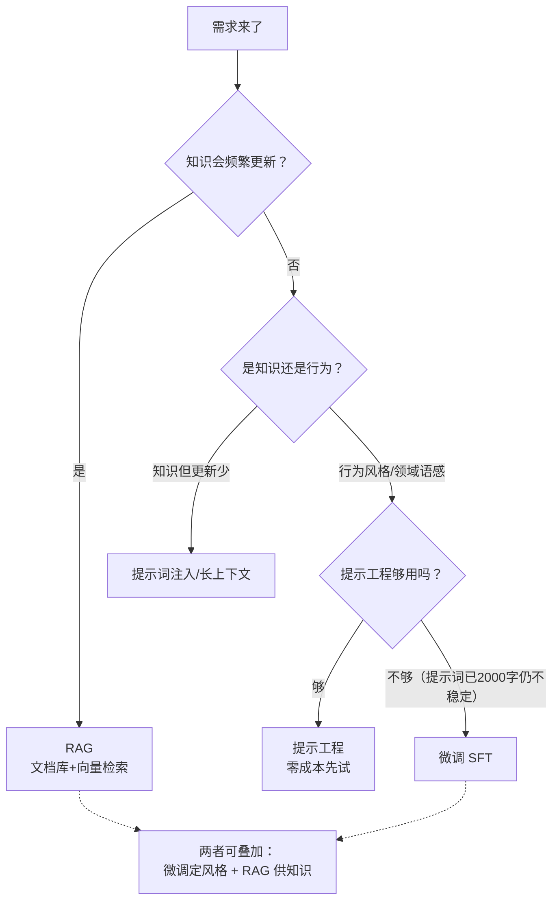

# 09 · 微调：什么时候轮到它，以及 LoRA 原理

面试必问："**RAG 和微调怎么选？**"——这篇给你决策框架，并把 LoRA 原理讲到能画图。先立住阶段认知（[01 篇](01-LLM应用开发全景.md)）：后端工程师是**调用方**，微调是"要不要训"的**选型判断**，训练本身是算法团队的事。

## 先泼冷水：80% 的"我们要微调"是错误提案

老板："把我们的产品文档喂给模型微调一下，它就懂我们业务了。"❌

**微调改变的是"行为风格"，不是"知识容量"**：

| 你想让模型学会的 | 正确手段 | 为什么不是微调 |
|----------------|---------|---------------|
| 新知识/文档/时效数据（"我们退货政策是 7 天"） | **RAG**（[03 篇](03-RAG与向量检索.md)） | 微调学进权重→更新要重训；RAG 换文档即生效 |
| 输出格式/语气/风格（永远输出严格 JSON、客服话术） | **微调 或 提示工程** | 这是"行为"不是"知识" |
| 领域术语与缩写（医疗/法律的行话） | 微调（小样本）+ RAG 兜底 | 行话要"内化"，文档检索又太碎 |
| 简单规则（"回答带免责声明"） | **提示工程**（[04 篇](04-AI工程化与learn-center落地.md)） | 杀鸡用牛刀，改提示零成本 |

### 选型决策树（面试画这张）



**先提示工程 → 再 RAG → 最后才微调**：成本和迭代速度反着排。learn-center 的 AI 答疑全程没微调——提示词 + RAG + Mock 降级就够工程落地（[04 篇](04-AI工程化与learn-center落地.md)）。

## SFT 全流程（知道即可，面试讲得出）

```
① 数据准备：prompt-completion 对（输入→理想输出），几百到几万条
   ❌ 数据量迷信：1 万条垃圾 < 500 条精心标注（质量 > 数量）
   ✅ 从线上 badcase 里捞——真实失败样本是最好的训练集

② 训练：全参微调（改全部权重，贵）vs LoRA（只训小附件，主流）

③ 评测：用 [08 篇](08-AI安全与评测.md) 的评测集——训练前后同一套题跑分对比，
   别凭感觉说"变好了"

④ 部署：LoRA 权重合并进基座模型 → vLLM 起服务 → 暴露 OpenAI 兼容端点
   → 调用方（你的 Spring AI 代码）零改动，只换 base-url
```

## LoRA 原理（核心考点，能画图）

**问题**：全参微调要更新权重矩阵的全部增量 ΔW（7B 模型 = 70 亿参数全动），显存爆炸、每任务存一份完整副本。

**LoRA 的洞察**：微调的增量矩阵是**低秩的**——变化集中在少数方向上，可以用两个小矩阵的乘积近似：

```
全参微调：  W' = W + ΔW          （ΔW 是 d×d 大矩阵，如 4096×4096 ≈ 1600 万参数/层）

LoRA：      W' = W + B·A        （W 冻结不动）
            B: d×r   A: r×d     （r 是秩，常取 8~64；r=16 时两矩阵合计 ~13 万参数/层）
                                        ↓ 参数量降 100 倍以上，单卡可训
推理时：    h = W·x + (B·A)·x   （原路径 + 旁路，可合并回 W 零额外延迟）
```

- **QLoRA**：基座模型再量化到 4bit + LoRA——消费级单卡（24G 显存）就能微调 7B
- **多任务复用**：W 不动，每任务只存一对小 B/A（几十 MB）——按请求切换 LoRA 权重 = **一个基座服务多个"人设"**（类似 Spring 里一个 Bean 多份配置）
- 为什么省显存的本质：**优化器只需要维护小矩阵的状态**（Adam 的动量/方差矩阵与可训参数同尺寸）——全参时它们跟 70 亿参数一样大，这才是显存大头

## Java 工程师的接入姿势

```
训练（Python 生态）→ 部署成 OpenAI 兼容端点 → 你这边只剩一行配置：

# learn-center 的 ChatPort 双实现（mock/real）早就是为这种切换准备的
lc.ai.base-url: http://your-vllm-host:8000/v1   # 换成微调模型服务
lc.ai.model: my-domain-7b-sft

提示词反而变短了：风格已内化进权重，原来 2000 字的 few-shot 系统提示可以砍半
  → 直接省 token 成本（这是微调的真实收益之一：省提示词钱）
```

**成本账**（量级感受）：微调一次（7B、几千条、LoRA）≈ 几十~几百元 GPU 时费 + 标注人力；RAG = 向量库存储 + 检索调用（近乎零边际成本）；提示工程 = 人力。**小团队默认 RAG，微调需要"行为不稳定已造成业务损失"来立项。**

## 面试问法

**Q: RAG 和微调怎么选？**
A: 先分清目标：**知识**（内容会变、要可溯源）用 RAG——文档进向量库，更新即生效、答案能带引用；**行为**（格式/风格/领域语感，提示词 2000 字仍压不稳）才微调。顺序：提示工程 → RAG → 微调，可叠加（微调定风格 + RAG 供知识）。微调用 LoRA：冻结原权重，只训低秩旁路 B·A（秩 8~64），显存降百倍，QLoRA 4bit 量化单卡可跑；部署为 OpenAI 兼容端点，调用方换 base-url 即接，还能缩短提示词省 token。

---

**下一篇**：[10-多模态应用](10-多模态应用.md) · 回 [stage7 README](README.md)。
